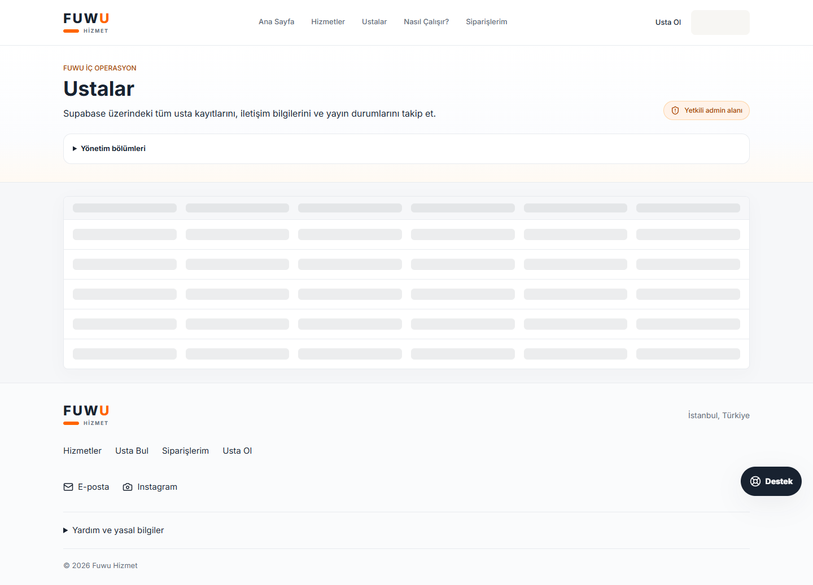
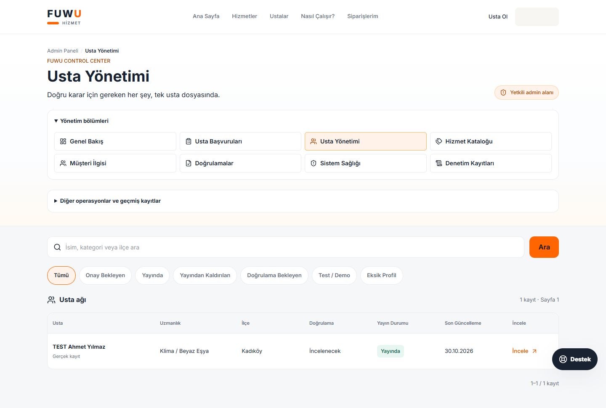
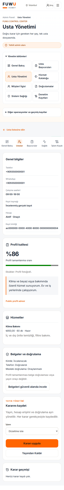

# FUWU admin eylem onarımı

Tarih: 30 Ekim 2026. Çalışma mevcut repository üzerinde yapıldı. Production yalnızca okundu; commit, push, deployment, production migration, ödeme açma veya production kayıt güncelleme/silme yapılmadı.

## Doğrulanan kök neden

Canlı projede 46 migration kaydı var; son sürüm `20260816000100`. Zincirde daha eski üç kayıt da eksik: admin management, app settings ve AI support. Repository'nin son hali 69 migration içeriyor. Sadece son kalite migration'ını uygulamak yeterli değil.

Canlı Supabase loglarında şu POST çağrıları doğrulandı:

| UTC zaman | RPC | Sonuç |
| --- | --- | --- |
| 2026-10-30 09:50:56.176 | `consume_user_rate_limit` | 404, `PGRST202` |
| 2026-10-30 09:50:59.642 | `admin_provider_quality_queue` | 404, `PGRST202` |

`checkDatabaseRateLimit()` production'da kalıcı hız sınırlama kaynağı bulunmadığında isteği engelliyordu. `updateAdminProviderStatus()` bu kontrolü UPDATE'den önce yapıyor, hata ayrımını genel başarısızlık mesajında kaybediyordu. Kalite kuyruğu da mevcut olmayan RPC'ye bağlıydı.

Canlı metadata kontrolü admin SELECT/UPDATE politikalarını ve authenticated UPDATE grant'ini doğruladı. Providers tablosunda yalnızca `providers_set_updated_at` trigger'ı bulundu. Herhangi bir RLS veya trigger kaldırılmadı. Yeni akışın çalışması gerekli şema kurulmadan mümkün değildir; güvenliği atlayan fallback eklenmedi.

Kanıtlar: [salt okunur inceleme](../artifacts/control-center/production-readonly.json), [tüm public metadata](../artifacts/control-center/production-schema.json), [şema karşılaştırması](../artifacts/backend-reliability/schema-comparison.json).

## Yeni işlem sözleşmesi

`ProviderInspector` → `updateProviderStatusAction` → `runProviderControl` → `admin_provider_action` akışı kullanılır. `updateAdminProviderStatus` ve `updateAdminProviderTrust` da aynı yetkili RPC'ye yönlenir. Eski gerekçesiz doğrudan UPDATE yolu kaldırıldı.

1. Server Action oturumu ve profiles tablosundaki admin rolünü doğrular. RPC de aynı yetkiyi bağımsız denetler.
2. Provider ID, eylem, en az 10 karakter gerekçe, beklenen sürüm ve UUID işlem kimliği kontrol edilir.
3. RPC sabit 30/dakika sınırını uygular; kayıt ve yayın incelemesini aynı kilit sırasıyla alır.
4. Sürüm token'ı provider ve yayın kararının güncel halini kapsar. Değişmiş kayıtta `40001` döner.
5. Değişiklik, audit kaydı ve idempotency receipt tek transaction'da yazılır. Audit hatasında hepsi geri alınır.
6. Server Action dönen sonucu kontrol eder ve commit sonrasında ayrı bir RPC SELECT ile sürüm/yayın durumunu tekrar okur.
7. Başarıdan sonra admin, partner, ana sayfa, usta listesi, hizmetler ve public profil yolları yeniden doğrulanır.

İstek ağda kesilirse aynı kimlikle tekrar gönderilir. Bir başka yönetici daha sonra karar vermişse eski receipt yeni durumu ezmez; güncel sürüm kontrolü çatışma gösterir. Çift tıklama client ref kilidi ve DB receipt ile korunur.

| İşlem | Değişen alan | Korunan kayıtlar |
| --- | --- | --- |
| Yayından kaldır | Yayın incelemesi `hidden` | Hesap, sahiplik, başvuru, siparişler, belgeler |
| Pasifleştir | `is_active=false`; yeni public rezervasyonlara kapanır | Hesap onayı ve geçmiş kayıtlar |
| Doğrulamayı kaldır | İlgili `is_verified` bayrağı | Diğer doğrulamalar ve değişmeyen içeriğin yayın kararı |
| Test olarak işaretle | Kaynak `test`, yayın `hidden` | Bütün tarihsel ilişkiler |
| Gerçek olarak işaretle | Kaynak `real`, yeniden inceleme | Otomatik yayın yapılmaz |
| Yayına onayla | Güncel fingerprint ve kaynak/kanıt kurallarıyla kalite onayı | Hesap onayı ayrı kalır |

Hesap onaylama tek başına yayına alma değildir. Belge değişimi ise eski kimlik/mesleki doğrulamayı kaldırır ve yeniden inceleme başlatır.

## Arayüz değişikliği

14 sütun ve `min-width:1100px` kaldırıldı. Masaüstünde yedi sütun, küçük ekranlarda kartlar var. İsim/kategori/ilçe araması, yedi filtre, sabit sıralama ve sunucuda 20 kayıtlık pagination kullanılır. Genel bilgiler, hizmetler, belgeler, kalite, yayın yönetimi ve son 30 karar usta dosyasındadır. Fiyat/saat/yanıt süresi ve doğrulama düzenleme korunur.

Şema/bağlantı hatası boş listeye dönüştürülmez; toplam `null` kalır ve “Usta sayısı bilinmiyor” gösterilir. Kayıtlı başarı mesajı: “Usta yayından kaldırıldı. Profil artık müşterilere gösterilmiyor.”

Başlıca dosyalar: `src/app/admin/providers/{page,actions,quality-actions}.tsx/ts`, `src/services/admin/{index,provider-control,provider-quality}.ts`, `src/components/admin/{AdminUI,ProviderInspector,ProviderQualityQueue,PrelaunchDashboard}.tsx`, `src/lib/providers/control.ts`, `src/styles/control-center.css`.

## Migration gereksinimleri

Yeni additive dosyalar:

- `20261030000200_provider_control_center.sql`: transaction RPC, receipt, paginated directory, private detail/readiness, dashboard özeti.
- `20261030000300_partner_store_preparation.sql`: usta kapsamı, mağaza değişiminde yeniden inceleme, özel belge eşleştirme ve profil hazırlama.

Henüz production'a uygulanmamış `20261022000200_fusion_quality_and_reviews.sql` içindeki koşulsuz geçmiş puan backfill'i kaldırıldı. Production sürümlerinden başlayan ilk yerel denemede `rating`, `review_count` ve `updated_at` değiştiği için koruma testi başarısız oldu. İlk hata [ayrı kanıtta](../artifacts/control-center/production-upgrade-backfill-detected.json) tutuldu. Kaynak veriler ve tarihsel cache'ler artık migration sırasında yeniden yazılmaz; yeni yorum işlemlerinin kendi trigger'ı korunur. Public ön lansman puanları yine gösterilmez.

## Gerçek test sonuçları ve sınırlar

- 118 birim testi geçti; 25'i yeni kontrol/hazırlık testidir.
- 69 migration temiz kurulumda ve dolu şemadan yükseltmede test edildi.
- Canlıda gözlenen 46 sürüm yerelde ayrı kuruldu; eksik 23 migration sentetik eski kayıtlar üzerinde sırayla uygulandı. Önceden var olan kolon değerlerinin korunması doğrulandı.
- Gerçek PostgreSQL oturumlarında idempotency, iki yöneticinin yarışması, audit başarısızlığında rollback ve RLS test edildi.
- Gerçek yerel Next.js/React/Server Action, sentetik Auth/REST ile 42 ekran-boyut birleşiminde kontrol edildi; yatay taşma ve browser exception görülmedi. Çift tıklama bir fixture RPC üretti.
- TypeScript ve production build geçti. İlk build timeout'u sonraki bağımsız build'de tekrar etmedi.
- Gerçek Supabase Auth/Storage E2E **çalıştırılmadı**: yerel Auth health bağlantısı `ECONNREFUSED`, Docker daemon kullanılamıyor. Kullanıcı yerel doğrulamayla devam edilmesini seçti.

Altı koşullu “Yayından Kaldır” tam Supabase E2E kabulü **PASS değildir**. Hazır test: `e2e/provider-control.spec.ts`. Yerel SQL ve fixture UI sonuçları bu kabulün yerine sunulmaz.

## Önce / sonra

Görüntüler sentetik kayıtlarla alınmıştır; canlı kişisel veri içermez.

## Güvenli test kaydı süreci

Dört aktif production kaydı salt okunur envantere alındı. İki kaydın sahibi ve birer başvurusu var; iki kayıtta sahip yok. Sorgulanan eski talep ilişkileri sıfır. Audit sayıları sırasıyla 1, 2, 1, 0. Sahibi bulunan iki kayıt için owner-prefix Storage taramasında sonuç yok; sahibi olmayan kayıtlarda bu tarama tam Storage kanıtı sayılmaz.

ID'ler ve ilişkiler `production-readonly.json` içindedir. İsim tahminiyle kayıt sınıflandırılmadı. Silme SQL'i veya otomatik toplu kapatma eklenmedi. Önce staging'de aynı ID/ilişki envanteri, ardından yetkili gerekçeli `mark_test`/`unpublish` kararı kullanılmalıdır. Hesap, audit, sipariş veya dosya temizliği ayrıca incelenmeden yapılmamalıdır. Şema uygulanmadığı için bu dört kayıt production'da bu çalışma tarafından gizlenmiş değildir.
