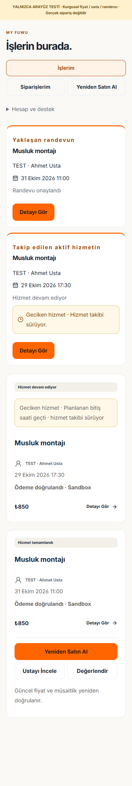
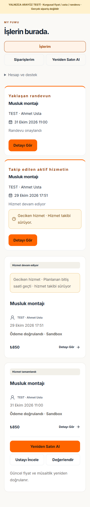
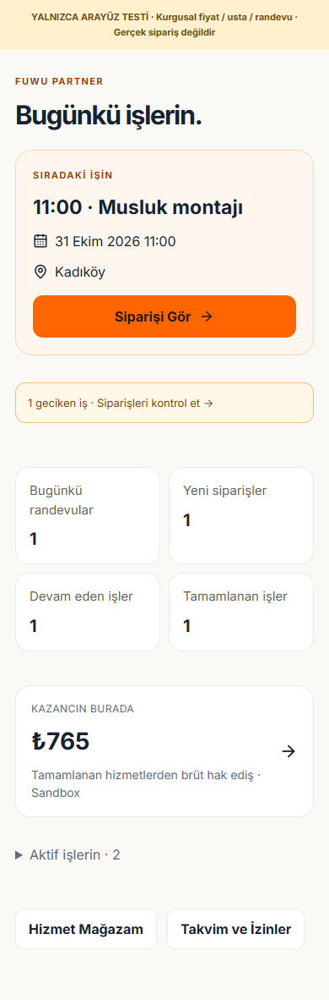
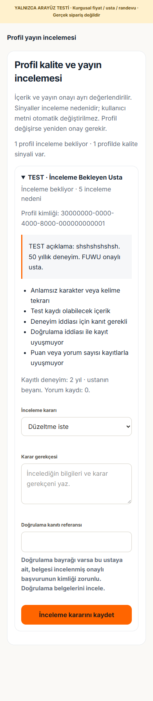
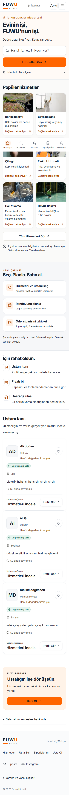
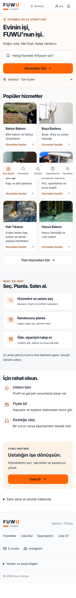

# FUWU — Final Product QA ve Production Readiness

**Çalışma: 29–30 Ekim 2026 · Europe/Istanbul. Karar: NO-GO / production yayını onaylanmadı.**

Önceki commit edilmemiş backend ve güvenlik çalışmaları korundu. Satın alma sırası değişmedi: **Hizmet → Usta → Gün/Saat → Adres → Ödeme → Sipariş Takibi.** Production ödeme, production migration, canlı kullanıcı verisi değişikliği, Git commit/push veya deployment yapılmadı.

Bu rapor önceki [mobil denetimini](FUWU_PREMIUM_MOBILE_UX_FINAL_AUDIT.md), [backend raporunu](FUWU_BACKEND_RELIABILITY_REPORT.md) ve [güvenlik raporunu](FUWU_SECURITY_AND_TEST_REPORT.md) tamamlar. [Makine tarafından okunabilir kabul kaydı](../artifacts/product-qa/acceptance.json), nihai kaynak/asset hash'lerini, test tarihlerini ve kapsamlarını içerir. Eski koşular güncel başarı gibi sayılmadı. **PASS**, belirtilen test kapsamı içindir; fixture, mock HTTP, izole SQL ve gerçek hesap E2E sonuçları birbirinin yerine kullanılmaz.

## Müşteri yolculuğu

| Adım | Güncel sonuç ve kanıtın sınırı |
| --- | --- |
| Kategori ve hizmet fotoğrafı | Gerçek yerel Next uygulaması anonim uzak veriyi okudu. 11 kategori, bağımsız bağlantıları ve görselleri kontrol edildi; kırık görsel yok. Arama, ilçe ve filtre diyaloğunun klavye odağı çalışıyor. |
| Usta, hizmet/paket ve doğru fiyat | Gerçek React bileşenleri ve mock API ile farklı usta/paket fiyatları, süre ve bölge değişiklikleri doğrulandı. Sunucu fiyatı/ücret teklifi olmadan ödeme açılmıyor. Uzak commerce şeması eksik olduğu için gerçek satın alma **BLOCKED**. |
| Gün/saat ve adres | Uygun günler API sonucuna bağlı. Boş/hatalı günler satın almayı kapatıyor. Geri dönüşte adres korunuyor; başka ilçenin kayıtlı adresi seçilmiyor. Usta/paket değişince geçersiz saat temizleniyor. |
| Google dönüşü | Offline PKCE/session/redirect kontrolleri ve fixture checkout dönüşü geçti. Hizmet, usta, paket, tarih/saat, adres ve özet taslağı korunuyor; kişisel adres URL'ye yazılmıyor. **Gerçek Google hesabıyla giriş yapılmadı.** |
| Ödeme özeti | Hizmet bedeli, ayrı platform ücreti, toplam, süre, kapsam, kapsam dışı işler ve iade koşulları görünür. Ücret değişirse eski onay geçersizleşiyor. İstemci fiyatı rezervasyona yetmiyor. |
| Ödeme hatasından kurtarma | Hold oluşup checkout başlatılamazsa aynı siparişe erişim korunuyor. Süresi geçmiş hold ödeme başlatmıyor; sahte iptal/ödendi durumu üretilmiyor. |
| Takip, destek ve yorum | Durumlar, geciken aktif iş, yeniden satın alma ve tamamlanmış hizmet yorumu fixture ile; sahiplik, ödeme/tamamlanma ve tek yorum koşulları SQL ile test edildi. Gerçek müşteri hesabıyla rol E2E yapılmadı. |

Satın alma ve operasyon fixture koşuları ayrı ayrı **13 kontrol** içerir. Kanıt: [checkout](../artifacts/product-qa/checkout/browser-tests.json), [operasyonlar](../artifacts/product-qa/operations/browser-tests.json). Bunlar Google veya iyzico işlemi değildir.

| Önce — müşteri paneli, fixture | Sonra — müşteri paneli, fixture |
| --- | --- |
|  |  |

## Usta yolculuğu

İlk ekrandaki bugünkü işler ve sıradaki randevu korundu. Yaklaşan işin saati, hizmeti ve ilçesi görünür; takvim ve sipariş bağlantıları doğru hedefe gidiyor. Geçmiş/geciken kayıtlar sıradaki randevuyu gizlemiyor.

Mağaza fiyatı, süre, hizmet bölgesi, çalışma saatleri ve izin kaydı gerçek bileşenlerle, mock HTTP üzerinden kontrol edildi. Hizmet tamamlama altı haneli teslim kodunu gönderiyor. SQL kontrolleri bu kodun ve durum geçişinin sunucuda doğrulanmasını kapsıyor. İzin eklemek mevcut onaylı siparişi iptal etmiyor.

Komisyon, brüt hak ediş, doğrulanmış kesinti sonrası net hak ediş ve kuruluş onayı ayrı gösteriliyor. Eksik kesinti net kazanç uydurmuyor; kuruluş onayı banka transferi olarak sunulmuyor. Müşteri yorumu uygunluğu ve sahte aggregate puanın gösterilmemesi ayrıca test edildi.

Google girişi, gerçek başvuru/belge yükleme, onaylı usta hesabıyla mağaza ve gerçek sipariş tamamlama E2E'si **BLOCKED**. Bu testler yapılmış gibi raporlanmıyor.

## Admin yolculuğu

Günlük siparişler ve başarısız ödemeler, geciken hizmetler, bekleyen iadeler, usta incelemeleri, GMV, komisyon, mutabakat ve audit alanları korundu. Finansal olmayan/eksik veri sıfıra çevrilmiyor. Veri okunamadığında metrik alanı gerçek bir sıfır gibi gösterilmiyor. Eksik veri fixture'ları, mutabakat bağlantısı ve sıfır kayıt halinde gereksiz alarm üretilmemesi doğrulandı.

Gerçek admin oturumu yok: panel görüntüleri fixture, yetkilendirme ve finans kuralları izole SQL/mocked servis testidir. Anonim `/admin` ve `/admin/marketplace` istekleri gerçek yerel uygulamada girişe yönlendi.

### Profil kalite ve yayın onayı

Anonim, salt okunur uzak tarama **4 aktif/onaylı profil** gördü; **3 profilde doğrulama tutarsızlığı sinyali**, bunlardan birinde ayrıca anlamsız karakter tekrarı bulundu. İsimler, açıklamalar, telefonlar veya anahtarlar denetim JSON'una kaydedilmedi. Bunlar dolandırıcılık/küfür/sahte deneyim hakkında kesin hüküm değildir. Yorum RPC'si eksik; doğrudan anonim yorum okuması tam veri görünürlüğünü kanıtlamaz. Puan denetimi bu nedenle sınırlıdır. [Tarama kanıtı](../artifacts/product-qa/public-profile-audit.json).

- Ayrı `provider_publication_reviews` kaydı; inceleme bekliyor, onaylı, düzeltme istendi ve yayın durduruldu kararlarını tutar. Eski profil, sipariş, yorum ve ödeme satırları yeniden yazılmaz.
- Mevcut profiller ayrı inceleme kuyruğuna alınır. İçerik/doğrulama bilgisi değişince içerik parmak izi değişir ve eski onay geçersiz olur. Eski içerik ekranından verilen onay reddedilir.
- Admin gerekçe girer. Doğrulama bayrağı olan profilde, aynı ustaya ait belge yolu bulunan **onaylı başvuru kimliği** gerekir. Uydurma referans, başka durumdaki başvuru veya eski bayrak tek başına rozet oluşturmaz. Belge içeriğinin gerçekliği yine yetkili insan incelemesidir.
- Kamuya açık puan ve yorum sayısı yorum kayıtlarından hesaplanır; saklanan rastgele aggregate puan taşınmaz. Doğrulama kaydı iptal edilirse doğrulandı rozeti gösterilmez.
- Kamu listesi, teklif, slot ve yeni ödeme başlangıcı yayın koşuluna bağlıdır. Admin/usta kendi yönetim erişimini ve eski siparişlerini korur. Karar ve audit atomiktir; audit yazılamazsa onay geri alınır.

Migration **yalnızca yerelde hazırlanıp test edildi**. Canlı profiller silinmedi, düzeltilmedi veya canlı kuyruğa taşınmadı. Yerel frontend, uzak yayın RPC'si yokken eski profillere güvenli yayın/rozet varsayımı yapmaz. Bu yüzden güncel yerel listede profil görünmemesi bir şema/rollout engelidir; gerçek kullanıcı kaydı silinmiş değildir.

Yeni migration: [20261029000300_provider_publication_quality.sql](../supabase/migrations/20261029000300_provider_publication_quality.sql). Staging rollout'unda kuyruğun insan tarafından incelenmesi gerekir; doğrudan production'a uygulanacak bir komut verilmedi.

## Mobil kalite

- Gerçek uygulamadaki 7 sayfa **320, 360, 375, 390, 430, 768, 1024, 1440px** genişliklerinde kontrol edildi: 56 yerleşim; yatay taşma ve kırık görsel yok.
- 12 panel/ekran fixture'ı aynı 8 genişlikte kontrol edildi. Müşteri, usta, finans, admin, bilinmeyen veri ve kalite inceleme ekranları dahil.
- Form/gövde metni 16px; mobil alt sekme etiketi en az 12px. Kritik CTA ve geri düğmesi dokunma alanları test edildi; 320px geri düğmesi 44px'e çıkarıldı. Satın alma özetinde her genişlikte bir görünür ana ödeme CTA'sı var.
- Safe-area, tarih/saat etiketleri, görünür odak, reduced motion, yatay görünüm ve %200 yazı kontrolleri korundu. Klavye ile filtre diyaloğunda odak ve Escape dönüşü doğrulandı.
- İşletim sistemi koyu tercihinde açık FUWU teması ve form kontrolleri okunur kalır. **Ayrı bir koyu tema geliştirilmedi.** Fiziksel cihaz, VoiceOver/TalkBack ve 40–65 yaş kullanıcılarla saha testi yapılmadı.
- Depolama engellenince çerez bildiriminin uygulamayı hataya düşürmesi düzeltildi. Reddet eylemi depolama olmadan çalışır; saklanmamış onay analitik izni sayılmaz.

axe ile 7 gerçek sayfa ve 12 fixture ekranında otomatik WCAG 2 A/AA, 2.1 A/AA, 2.2 AA ihlali bulunmadı. Bazı fotoğraf/kontrast sonuçları `incomplete`; bu sonuç AA sertifikası veya insan ekran okuyucu testi değildir. Kanıt: [gerçek uygulama](../artifacts/product-qa/after/public-audit.json), [paneller](../artifacts/product-qa/after-components/component-audit.json).

| Önce — gerçek yerel uygulama | Sonra — gerçek yerel uygulama |
| --- | --- |
|  |  |

## Performans

**Ölçümler canlı deployment ölçümü değildir.** Yerel Next production derlemesi, Edge/Chromium ve Lighthouse mobil varsayılan simülasyonu kullanıldı: 150ms RTT, 1638,4 Kbit/s, 4× CPU yavaşlatma. Her fazda ana sayfa üç, katalog bir kez ölçüldü. Tarayıcı önbelleği her Lighthouse koşusunda sıfırlanır; sunucu cache'i/uzak bağlantı gecikmesi gerçek production CDN'i temsil etmez. INP için gerçek kullanıcı örneği yok; TBT, INP diye sunulmaz.

| Mobil laboratuvar ölçümü | Önce | Sonra | Kabul |
| --- | --- | --- | --- |
| Ana sayfa LCP · üç örnek | 7,26 / 5,48 / 6,57 sn | 3,99 / 3,83 / 4,04 sn | Medyan **6,57 → 3,99 sn**; yaklaşık %39 azalma. **2,5 sn hedefi karşılanmadı.** |
| Katalog LCP · bir örnek | 6,56 sn | 3,80 sn | **2,5 sn hedefi karşılanmadı.** Tek örnek, saha istatistiği değildir. |
| CLS · en yüksek değer | 0,000106 | 0 | ≤0,1 laboratuvar hedefi geçti. |
| Ana sayfa TBT · medyan | 823ms | 123,5ms | INP ölçümü değildir. |
| Ana sayfa toplam aktarım · medyan | 1.076.725 bayt | 527.288 bayt | İçerik/ortam sınırlamaları aşağıda. |
| Ana sayfa ikinci örnek JS aktarımı | 295.782 bayt | 222.195 bayt | Aynı anonim profil verisiyle dolu staging tekrarı gerekli. |
| INP | Veri yok | Veri yok | Gerçek kullanıcı verisi yok. |

Nihai ölçüm build kimliği: `5viElv3j6jEGkf9qKD_zj`. Ana sayfa TTFB örnekleri son koşuda 500/33/23ms, katalogda 15ms idi. Bunlar yerel sunucu ölçümleridir; production TTFB değildir.

**Lighthouse sınırlaması:** Önce ve sonra koşularının tamamı yükleme zaman sınırı nedeniyle sonuçların eksik olabileceği uyarısını verdi. Runtime error raporlanmadı; ancak bu uyarı nedeniyle sayılar kesin production kabul kanıtı sayılamaz. Ayrı normal tarayıcı kontrolünde gerçek `load` olayı ana sayfada yaklaşık 471ms, katalogda 299ms içinde gerçekleşti; bu kontrol ağ/CPU yavaşlatması olmadan yapıldı ve mobil LCP yerine kullanılmaz. [Load kontrolü](../artifacts/product-qa/load-event-check.jsonl). Performans betiği 2,5 saniye eşiği sağlanmadığı için nonzero exit verdi; bu sonuç PASS olarak gizlenmedi.

Ölçülen darboğazlar ve değişiklikler:

| Alan | Bulgu / sonuç |
| --- | --- |
| TTFB ve Supabase | Başlangıç örneğinde TTFB 1622ms, sonraki iki örnekte 77/41ms. Uzak anonim sorguların süreleri ayrı JSONL dosyalarında kayıtlı; bunlar SQL execution süresi değildir. SQL plan/production DB profiler erişimi yok. Commerce sorguları zaten paralel. |
| Serial fetching | Ana sayfa kategori keşfi tüm commerce RPC/servis sorgularını bekliyordu. Gerçek, herkese açık kategori/ilçe okuması ayrıldı; iki kaynak paralel ve 60 saniye cache'li. Fiyat, slot, yayın kararı ve ödeme cache'lenmedi. |
| Font | Beş Inter dosyası 570.124 bayttan 109.784 bayta indi; Türkçe karakterler ve ₺ korundu. Tüm ağırlıkları zorunlu preload etme kaldırıldı; `font-display: optional` kullanılıyor. 120 KB font bütçesi regresyon testinde. |
| Görsel | LCP öğesi ilk kategori fotoğrafı. İlk iki kategori yüksek öncelikli; WebP, responsive kaynak ve sabit alanlar korunuyor. Fotoğrafı kaldırarak/boş içerik göstererek hedefe ulaşılmış sayılmadı. |
| JavaScript / hydration | Header ve mobil gezinme ayrı profil istekleri yapıyordu. Ortak, sunucunun doğruladığı profil kullanılıyor. Anonim keşif Auth/Realtime SDK'sını zorunlu yüklemiyor; girişli kullanıcıda gerçek SDK olayları korunuyor. Bildirim bileşeni ihtiyaç halinde yüklenir. SDK parçası yüklenemeyince doğrulanmış profil kaybolmaz. |
| Prefetch / üçüncü taraf | Kategori kartlarının toplu arka plan prefetch'i kapatıldı; bağlantılar çalışır. Vercel analytics/speed scriptleri açıkça etkinleştirilmedikçe yüklenmez. Meta Pixel mevcut izin kontrolünü korur. |
| Sentry | Önceki DSN ayrımı korundu: DSN yokken browser SDK gönderilmez; yapılandırılmış browser ve sunucu SDK'sı kaldırılmadı. Ölçümde DSN yok. Yapılandırılmış production Sentry yükü ayrıca staging'de ölçülmeli. |
| CSS deneyi | Inline CSS ayrı ölçüldü; yeterli fayda sağlamadı ve deneysel ayar nihai kaynaklardan çıkarıldı. Tasarım ve güvenlik başlıkları korunuyor. |

**Karşılaştırma sınırı:** Son yerel uygulamada yayın RPC'si uzak şemada bulunmadığından profil bölümü gösterilmiyor. Ölçüm, aynı dolu/onaylı profil verisiyle yapılmış eşdeğer production karşılaştırması değildir. Dolu staging kataloğu ve onaylı profillerle hız testi tekrarlanmalı. Ham Lighthouse gözlem ayrıştırması ile simüle LCP farklı yöntemlerdir; ayrıştırma süreleri simüle LCP toplamı gibi toplanmaz.

Kanıt: [önce](../artifacts/product-qa/before/performance.json), [sonra](../artifacts/product-qa/after/performance.json), [font boyutları](../artifacts/product-qa/font-sizes.json). Ara font ve CSS denemeleri `intermediate/`, `intermediate-fonts/`, `css-inline-experiment/` altında tutuldu.

## Backend entegrasyonları

| Alan | Sonuç |
| --- | --- |
| Tüm migration zinciri | 66 migration, temiz ve kayıtlı veri üzerinden yükseltme yollarında geçici PostgreSQL üzerinde test edildi. Bu Supabase platform/Auth/Storage E2E'si değildir. Yerel motor 18.4; projenin istediği PostgreSQL 17 üzerinde CI/staging tekrarı gerekir. |
| Veri koruma | Yeni kalite migration'ından önce/sonra provider, review, order, payment transaction ve legacy payment satırları birebir karşılaştırıldı. Silme/otomatik metin düzeltme yok. |
| Uzak Supabase | Güncel anonim `limit=0` kontrolleri: `service_catalog`, `service_variants`, favorites 404; review kaynak kolonları, kategori görünürlük/ücret ve orders commerce kolonları 400. Mevcut `orders.id` 200. İsim çakışması nedeniyle körlemesine migration güvenli kabul edilmiyor. |
| Migration ledger / staging | Yetkili metadata/ledger ve doğrulanmış ayrı staging erişimi yok. Yerel proje URL'si, deployment'ın production kimliği sayılmadı. Uzak onarım uygulanmadı. |
| Google | Auth settings GET: Google açık. Gerçek hesap/PKCE tarayıcı dönüşü ve staging redirect allowlist kabulü **BLOCKED**. |
| iyzico | Gerçek sandbox API key/secret yok. Hosted ödeme, processor callback/webhook, gerçek alt üye, gerçek refund/release mutabakatı **BLOCKED**. Offline sözleşme testleri geçti. |
| Yerel Auth E2E | Test hedefi loopback olarak sınırlandırıldı. Docker daemon çalışmıyor; gerçek izole Supabase Auth sağlıklı değil. E2E runner yazma testlerini başlatmadan **BLOCKED** verdi. |

Güncel kanıt: [sıfır satırlı şema denetimi](../artifacts/product-qa/backend-schema-current.json). Şüpheli veya belirsiz ödeme, önceki güvenlik onarımlarında olduğu gibi doğrulanmış/ödenmiş gibi tamamlanmaz.

## Güvenlik

Önceki RLS, sunucu fiyatı, rol güven sınırı, ödeme imzası/snapshot eşleşmesi, idempotency, mutation Origin/gövde sınırı, hata gizleme, request ID ve audit atomikliği korundu. Kamu profili sorgusu ek olarak süre sınırına alındı. Yeni yayın/RPC/karar fonksiyonları açık ACL, admin kontrolü ve güvenli `search_path` kullanır; müşteri/usta yayın kararı veremez. Onay audit yazımından ayrı başarıya dönüşmez.

Sunucu/ödeme anahtarları ekrana veya rapora yazılmadı. Test sarmalayıcıları production hedeflerini engeller. HTTP kontrollerinde gerçek localhost yanıtlarında CSRF, yetkisiz erişim, 64 KB gövde sınırı, nonce CSP, `no-store`, korelasyon ID'si ve ham SQL/token bilgisinin sızmaması doğrulandı.

## Test sonuçları

| Kontrol | Sonuç | Güncel kanıt / kapsam |
| --- | --- | --- |
| Migration zinciri / temiz | PASS · 66 migration, 6 kontrol | [Temiz kurulum](../artifacts/security-testing/migration-chain.json) |
| Migration zinciri / kayıtlı upgrade | PASS · 66 migration, 7 kontrol | [Upgrade](../artifacts/security-testing/migration-upgrade.json) |
| Commerce PostgreSQL / temiz | PASS · **108 kontrol** | [SQL sonuçları](../artifacts/security-testing/db-clean/database-tests.json) |
| Commerce PostgreSQL / upgrade | PASS · **109 kontrol** | [SQL upgrade](../artifacts/security-testing/db-upgrade/database-tests.json) |
| Toplam migration/SQL yürütmesi | PASS · **230** | Aynı senaryolar iki kurulum yolunda tekrar çalışır; 230 farklı senaryo iddiası değildir. |
| Birim testleri | PASS · **90**, sıfır fail/skip | [Unit](../artifacts/security-testing/unit.json) |
| Coverage | PASS · aynı 90 test | Kritik seçili finans/güvenlik dosyalarında %100 line/branch/function/statement. Projenin tüm dosyaları için %100 iddiası değildir. [Coverage](../artifacts/security-testing/coverage/coverage-summary.json) |
| Güvenlik kontrolü | PASS · **27 Node testi + dependency audit kapısı = 28** | Statik güvenlik kontrolü de geçti. Audit'te low/moderate/high/critical bulgu yok; bu, koşu anındaki advisory sonucudur. [Sonuç](../artifacts/security-testing/security-result.json). |
| Offline ödeme/Auth/fault injection | PASS · **77 kontrol** | Gerçek iyzico/Google çağrısı yok. [Mock sonuç](../artifacts/security-testing/mock-result.json) |
| Kritik gerçek localhost API | PASS · **20 kontrol** | [HTTP](../artifacts/product-qa/http-guards.json); dış entegrasyonlar kapalı. |
| Panel bileşenleri | PASS · 16 kontrol; 12 ekran × 8 genişlik | [Fixture panel sonuçları](../artifacts/product-qa/after-components/component-audit.json) |
| Satın alma / operasyon fixture'ları | PASS · ayrı ayrı 13 kontrol | [Checkout](../artifacts/product-qa/checkout/browser-tests.json), [operasyon](../artifacts/product-qa/operations/browser-tests.json) |
| Sipariş desteği / iptal fixture'ı | PASS · 2 kontrol | Hata sonrası tekrar deneme, `DISPUTED` destek geçişi ve `CANCELLED` iptal payload'ı; [kanıt](../artifacts/product-qa/support-browser.json). Gerçek sipariş değişmedi. |
| Ortak oturum/rol gezinmesi | PASS · 2 kontrol | Mock HTTP ve SDK olayları; [session](../artifacts/product-qa/session-browser.json). Development StrictMode iki mount isteği üretir; üç tüketici her isteği paylaşır. |
| Gerçek public sayfalar | PASS · 7 sayfa, 56 yerleşim | [Kamu uygulaması](../artifacts/product-qa/after/public-audit.json); 7 korumalı hedef 307 ile girişe yönlenir. |
| Fotoğraf / net hak ediş / Sentry ayrımı | PASS | `scripts/test-premium-mobile.ts`; yapılandırılmış browser ve server SDK korunur. |
| ESLint / TypeScript / production build | PASS | [Lint](../artifacts/security-testing/lint-result.json), [TypeScript](../artifacts/security-testing/typecheck-result.json), [build](../artifacts/security-testing/build-result.json). Ayrıca anonim salt okunur ortamda production build alındı. |
| Gerçek Supabase Auth rol E2E | **BLOCKED** | Sağlıklı izole Auth yok; yazma testleri çalışmadı. [E2E gate](../artifacts/security-testing/commerce-e2e-result.json) |
| Gerçek Google ve iyzico sandbox E2E | **BLOCKED** | Gerçek hesap/merchant kimlik bilgisi yok; fixture/mocks başarı yerine sayılmadı. |
| Release gate | **BLOCKED** | [Gate](../artifacts/security-testing/release-gate.json): yerel kapılar geçti; commerce E2E, Google, iyzico, staging şema ve P0 kabul kanıtı açık. |

Ara testlerde yakalanan SQL bileşik alan erişimi, eksik fixture şema alanları, erişilebilir select etiketi ve eski başarı metni beklentisi düzeltildi; ilgili koşular yeniden geçti. Deneysel inline CSS kazanç sağlamadığı için çıkarıldı. Mobil 2,5 saniye LCP kabul eşiği ayrı değerlendirilir; işlevsel testlerin geçmesi bu eşiği geçmiş sayılmaz.

Tekrar üretim komutları: `npm run test:integration`, `npm run test:mock`, `npm run test:unit:coverage`, `npm run test:security`, `npm run typecheck`, `npm run check:lint`, `npm run check:build`, `npm run test:http`, `npm run test:e2e:commerce`. Tarayıcı fixture betikleri: `audit-premium-components.mjs`, `verify-phase2-checkout.mjs`, `verify-direct-commerce.mjs`, `verify-product-session.mjs`. Bunlarda bu makinedeki kurulu Edge kanalı kullanıldı. Kamu uygulama denetimi `audit-premium-public.mjs`, performans `measure-product-qa.mjs` ile yapılır; uygulama hedefleri loopback'tir.

## Kalan eksikler

| Öncelik | Açık iş / durum |
| --- | --- |
| P0 | Uzak commerce şema/`orders` sözleşmesi ve ledger uyuşmazlığı. Yetkili metadata incelemesi ve ayrı staging onarımı gerekli; production'a dokunulmadı. |
| P0 | Gerçek iyzico sandbox ödeme → callback → komisyon → tam iade → settlement/mutabakat kabul zinciri. Anahtar ve test merchant erişimi olmadan başarılı sayılmaz. |
| P1 | Gerçek Google hesabıyla müşteri ve usta giriş/geri dönüşü; gerçek izole Auth/rol E2E. |
| P1 | Yeni kalite migration'ının staging rollout'u ve insan yayın incelemesi. Canlı şüpheli profiller henüz taşınmadı; yanlış sırada frontend/DB rollout'u listeyi boş bırakır. |
| P1 | Mobil LCP 2,5 saniye hedefi; dolu staging verisi ve yapılandırılmış izlemeyle tekrar. INP/RUM verisi yok. |
| P1 | PostgreSQL 17 / gerçek Supabase RLS, Storage, cron ve platform kabulü; yerel PostgreSQL 18.4 testleri bunun yerine geçmez. |
| P2 | Fiziksel iOS/Android, ekran okuyucu, farklı sistem metin boyutları ve 40–65 yaş kullanıcı testi. Otomatik kontrast `incomplete` alanlarının insan kontrolü. |

## Production yayın kararı

**NO-GO.** Yerel düzeltmeler ve regresyonlar, production güvenilirliği için gerekli dış servis/şema/rol kabulünün yerine geçmez. Commit/push/deployment ve production migration onayı istenmeden uygulanmadı. Sonraki somut adım, doğrulanmış ayrı staging ortamında şema/ledger uyuşmazlığını çözmek; ardından gerçek Google ve iyzico sandbox zincirini ve dolu veriyle mobil performansı doğrulamaktır. Production canlı ödeme aktivasyonu kapalı kalır.
