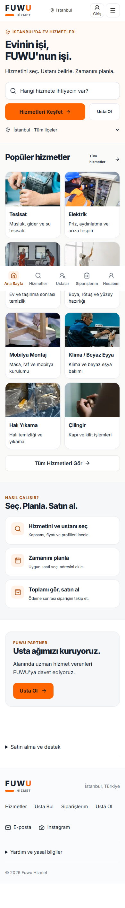
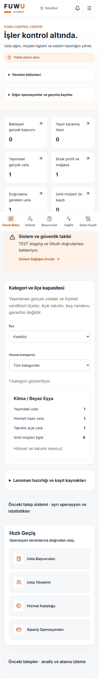
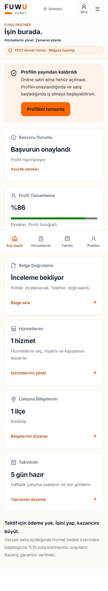
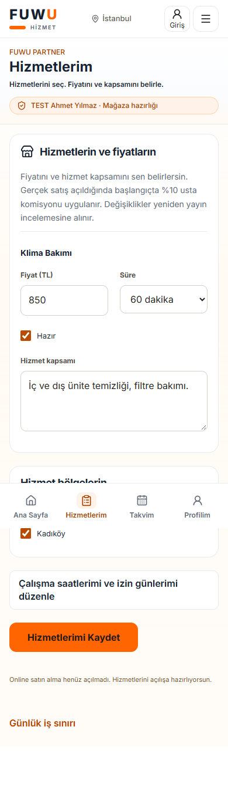

# FUWU Marketplace 3.0 — nihai denetim

Tarih: **30 Ekim 2026 · Europe/Istanbul**. Depo: `melikezana/fuwu`.

**Teslimat: yerel uygulama ve doğrulama. Hosted staging ve gerçek Auth/Storage/OAuth kabulü BLOCKED. Production yayınına hazır onayı verilmemiştir.**

Mevcut Control Center, Partner Panel, doğrudan satın alma, komisyon, audit, güvenlik ve migration mimarisi üzerinde çalışıldı. İkinci uygulama veya alternatif satın alma sistemi kurulmadı. Başlangıç çalışma ağacı temizdi; yerel main ve GitHub main aynı `68df0ebfb889f6d2f60406366709d939aead4597` commit'indeydi. Değişiklikler commit edilmeden çalışma ağacında bırakıldı.

Gerçek ödeme ve müşteri checkout'u kapalıdır. Commit, push, PR merge, production deployment, production migration, gerçek kullanıcı/usta silme veya production kayıt güncellemesi yapılmadı. Uzak FUWU veritabanında yalnızca metadata, migration ledger, güvenlik uyarıları ve izin verilen ücret ayarları okundu. Uzakta yapılan tek oluşturma denemesi, kullanıcının seçtiği organizasyondaki bağımsız staging projesiydi; kota nedeniyle reddedildi ve proje oluşmadı.

## 1. Güncel repo ve önceki çalışma

Özellikle şu raporlar ve karşılık gelen kod/testler incelendi:

- `FUWU_ADMIN_ACTION_REPAIR.md`
- `FUWU_PROVIDER_PARTNER_UX.md`
- `FUWU_PROVIDER_SECURITY_QA.md`
- `FUWU_PRELAUNCH_MARKETPLACE_AUDIT.md`
- `FUWU_BACKEND_RELIABILITY_REPORT.md`

Son commit `68df0eb`, admin/usta işlemlerinin transaction RPC ve hazırlık ekranlarını içeriyor. Önceki `7c173f3` ön lansman güvenini, `0d491df` backend ve mobil test çalışmalarını içeriyor. Bu değişiklikler korundu. Önceki tarihsel migration dosyaları bu çalışmada yeniden yazılmadı.

Açık [PR #1](https://github.com/melikezana/fuwu/pull/1) taslak ve merge edilmemişti. İncelenen head `f62acea30db260f4b3b3237adc52ca6b498444a5`: backend quality başarılı, Supabase E2E başarısız. E2E, Playwright başlamadan `check:backend:db` adımında duruyordu. Galeri tablosu erişilebilirken eski sağlık RPC'sinin sabit metadata listesinde yoktu; üç kontrol yanlış biçimde eksik tablo/RLS raporluyordu.

Main'in mevcut GitHub işlerinde kalite akışı PostgreSQL 17 kurulumunda, E2E akışı Node 22 ile `npm ci` adımında duruyordu. PR'daki ilgili CI, timeout ve hata yönetimi düzeltmeleri güncel kodun üzerine taşındı; PR otomatik merge edilmedi. Yeni yerel kod için GitHub CI çalıştırıldığı iddia edilmiyor.

Güncel Supabase ledger'ı **46 migration** içeriyor. Başlangıç repo zinciri 69'du; bu çalışma sonunda **70**. Böylece production'da uygulanmamış **24** repo migration'ı bulunuyor. `admin_provider_action`, `admin_provider_directory`, `admin_provider_detail`, `consume_user_rate_limit`, `launch_interest_health` ve `save_launch_interest` eksikliği metadata üzerinden yeniden doğrulandı.

Kanıt: [remote-audit.json](../artifacts/marketplace3/remote-audit.json), [şema karşılaştırması](../artifacts/marketplace3/database/schema-comparison.json).

## 2. Control Center

Ana başlık **“İşler kontrol altında.”** oldu. İlk görünüm altı operasyon göstergesine indirildi:

1. İnceleme bekleyen, kaynağı gerçek olarak sınıflandırılmış başvurular.
2. Profil, hizmet, takvim ve doğrulaması tamamlanmış; yayın kararı bekleyen ustalar.
3. Yayındaki gerçek ustalar.
4. Eksik profil veya mağaza hazırlığı.
5. Eksik kimlik/telefon doğrulamaları.
6. İzni geri çekilmemiş müşteri ön kayıtları.

Yeni başvuruların tamamı otomatik olarak gerçek kabul edilmez. Kaynak incelemesi yapılmamış başvuruların da bulunduğu toplam kuyruk, ayrı ayrıntı alanında korunur. “Yayın kararına hazır” olmak otomatik yayın anlamına gelmez.

Eski snapshot sözleşmesi desteklenir; üretilemeyen yeni ölçümler **Bilinmiyor** gösterir. Eksik RPC, ağ hatası, bozuk sayaç, bilinmeyen sürüm veya kısmi payload sıfır kayıt gibi sunulmaz. Test/kaynağı belirsiz profiller yeni gerçek hazırlık ölçümlerine katılmaz.

Kategori/ilçe kapasitesi tüm aktif eşleşmeleri kapsar. Operatör ilçe ve kategori seçebilir; yayınlanan profilleri, hizmet bölgelerini, takvimi açık ustaları ve izinli müşteri ilgisini görebilir. Takvim kaydı, belirli bir randevunun boş olduğu iddiası değildir. Eski şemada yalnızca pilot verisi varsa kapsam açıkça belirtilir.

Sekiz ana bölüm korunur: Genel Bakış, Usta Başvuruları, Usta Yönetimi, Hizmet Kataloğu, Müşteri İlgisi, Doğrulamalar, Sistem Sağlığı, Denetim Kayıtları. Navigasyon ve geçmiş operasyonlar açılır alanlara alındı. Usta tablosu altı sütuna indirildi; mobil kartlar ve mevcut detay dosyası korunur.

`ProviderInspector → Server Action → runProviderControl → admin_provider_action` zinciri korunur. Yayından kaldırma, pasifleştirme, doğrulama kaldırma ve test sınıflandırması gerekçe/onay, DB rol kontrolü, sürüm kontrolü, idempotency receipt, atomik audit ve commit sonrası yeniden okuma kullanır. Yetkisiz doğrudan UPDATE fallback'i eklenmedi. SQL testlerinde kamuya açık görünürlük ve ilişki korunması doğrulandı.

### Sistem Sağlığı düzeltmesi

Genişletilmiş mobil tur, sağlık sayfasında eksik/kısmi RPC yanıtının `.find`/`.map` çökmesine neden olduğunu ortaya çıkardı. Sağlık görünümü mevcut rota içinde finans sorgularından ayrıldı. Sağlık ve analiz payload'ları doğrulanır; ağ/şema hatasında açık bilinmiyor durumu gösterilir. Geçersiz veya gelecekteki kontrol tarihi başarılı kanıt sayılmaz. Tanım listesi HTML yapısı erişilebilirlik taramasındaki hataya göre düzeltildi.

## 3. FUWU Partner

**“İşin burada.” / “Hizmetlerini yönet. Zamanını planla.”** korundu. Başvuru kararı artık DB'deki son başvuru durumundan gelir; profil tamamlama aşaması, onay ve yayın ayrı gösterilir.

Mobil navigasyon Ana Sayfa / Hizmetlerim / Takvim / Profilim olarak kalır. Tablet genişliklerinde Partner menüsünün kaybolduğu aralık giderildi. Profil, belge, hizmet, bölge ve takvim kartları korunur. Kazanç veya sipariş sayısı uydurulmaz.

Hizmet ekranı fiyat, süre, kapsam ve ilçelere odaklanır. Çalışma saatleri ve izin günleri Takvim ekranında düzenlenir. Günlük kapasite ayarı hizmet ekranının başından alınarak ayrıntıya taşındı. Usta, takvimini henüz tamamlamadan hizmet hazırlayabilir; bu işlem yayın veya satış açmaz.

**Veri bütünlüğü:** Hizmet ve takvim ayrı RPC'lerle kaydedilir. Takvim kaydı eski fiyat/kapsam snapshot'ını geri yazmaz; hizmet kaydı güncel çalışma saatlerini ve izin tarihlerini korur. Aynı provider kilidi mevcut commerce işlemleriyle paylaşılır. Kayıtlar audit üretir ve yeniden yayın incelemesine alınır. Başka usta bu RPC'leri çağıramaz.

Mağaza API'sine kalıcı hız sınırı, yeni doğrudan RPC'lere de sabit DB hız sınırları eklendi. Paket eklemenin çift tıklama kilidi düzeltildi. Profil/belge ağ hataları ham hata metni veya sahte başarı yerine anlaşılır sonuç verir.

İş fotoğrafı ve profil fotoğrafı yüklemesi mevcut doğrulama/Storage akışında kalır. Dosya alanlarına erişilebilir adlar eklendi; fotoğraf ve galeri kontrollerinin dokunma alanları iyileştirildi. Usta kendisini doğrulayamaz veya admin rolü kazanamaz.

## 4. Müşteri keşfi ve ön kayıt

Ana slogan ve açıklama korunur:

> Evinin işi, FUWU'nun işi.
>
> Hizmetini seç. Ustanı belirle. Zamanını planla.

İlk mobil görünümde logo, konum, arama, popüler kategoriler ve **Tüm Hizmetler** bağlantısı erişilebilirdir. Bağlantının ilk 900 px mobil viewport içinde ve en az 44 px yüksekliğinde olduğu test edildi. Katalogdaki 11 aktif sentetik kategori Tüm Hizmetler ekranında eksiksiz erişilebilir; kategori bağlantısı gerçek filtreye gider.

Mevcut lisanslı, yerel WebP hizmet fotoğrafları ve kategori eşlemeleri korundu. Yeni sahte usta veya müşteri görseli eklenmedi. Gerçek usta yokken boş durum gösterilir; sıfır profil arasından puan karşılaştırma gibi anlamsız metin kaldırıldı. Bağlantı hatası ile gerçek boş liste ayrı kalır.

Ön kayıt yalnızca doğrulanmış hesabın e-postası, izin sürümü ve DB'nin döndürdüğü geçerli kayıt kimliğiyle başarılı sayılır. Sağlık RPC'si ağ hatası verirse sayfa çökmez; yeni kayıt kapalı gösterilir. Kayıt ve izin geri çekme transport hataları başarıya çevrilmez. Yeni kayıtlar kapalıyken doğrulanmış kullanıcı izin geri çekme işlemini yapabilir; gerçek yerel Server Action ile kontrol edildi.

Satın alma mimarisi Hizmet → Usta → Gün/Saat → Adres → Fiyat → Ödeme → Takip olarak korunur. Teklif bekleme modeli eklenmedi. Usta komisyonu başlangıçta **%10**, müşteri platform ücreti varsayılan **%0**. Production'da okunabilen `commission_rate` değeri de `10`; müşteri ücret ayarı henüz mevcut değil ve varsayılan sıfırdır. Yerel checkout bayrağı tanımlı değil; varsayılan kapalıdır. Ortak iyzico istemcisi canlı endpoint'i reddeder.

## 5. Migration ve güvenlik

Yeni additive migration: `supabase/migrations/20261030154616_marketplace3_operations_readiness.sql`. Dosya Supabase CLI ile oluşturuldu. Production'a uygulanmadı.

Migration şunları hazırlar:

- Sağlık katalog RPC'sinde gerçek public tablo/RLS/politika metadata'sı; eski FK/index/realtime sözleşmeleri korunur.
- Admin-only hazırlık ve kategori/ilçe kapasitesi snapshot'ı.
- Owner/admin kapsamındaki özel başvuru durumu.
- Ayrı, provider kilitli hizmet ve takvim kayıt RPC'leri.
- Açık EXECUTE grant/revoke, boş `search_path`, auth/ownership kontrolü, audit ve hız sınırı.

Sağlık metadata'sı yalnızca service-role'a açıktır. İç wrapper'lara authenticated doğrudan erişimi reddedildi. Yeni RLS bypass fallback'i veya public service-role anahtarı eklenmedi. Migration uygulanırken geçmiş provider, review, order veya payment verisi yeniden yazılmaz.

| Denetim | Doğrulama |
| --- | --- |
| Production RLS | Okunan 20 public tablonun 20'sinde açık; bu tek başına politika doğruluğu sertifikası değildir |
| Roller | User metadata ile admin olma, kendi rolünü/doğrulamasını değiştirme ve başka ustanın mağazasına erişim reddi |
| Admin işlemleri | Sürüm çatışması, tekrar istek, iki DB oturumu yarışı, audit hatasında rollback, public görünürlük |
| Storage/dosya | Özel belge bucket'ı, sahip prefix'i, boyut/MIME ve magic-byte kontrolleri; gerçek Storage HTTP E2E ayrı BLOCKED |
| CSRF/XSS | Mevcut Origin/body sınırları, güvenli redirect, React metin kaçışı ve statik client/server anahtar sınırları |
| Ödeme/veri | Değişmez fiyat/ücret snapshot'ı, slot yarışı, idempotency, doğrulanmamış ödeme/iade reddi |
| Oturum/OAuth | Mevcut SSR/cookie/callback mimarisi korundu; gerçek Google girişi test edilmedi |

Production advisor uyarıları ayrıca kaydedildi: üç mutable search_path, dokuz anon ve on bir authenticated SECURITY DEFINER uyarısı, kapalı sızmış parola koruması. Bunlar dört uyarı grubudur; aynı fonksiyon iki rol grubunda bulunabilir. İncelenen örnek RPC'lerde auth/ownership kontrolü vardır; uyarılar otomatik olarak doğrulanmış exploit sayılmadı. Production izinleri veya Auth ayarları bu çalışma tarafından değiştirilmedi.

İlgili resmî açıklamalar: [RLS](https://supabase.com/docs/guides/database/postgres/row-level-security), [Data API güvenliği](https://supabase.com/docs/guides/api/securing-your-api), [search_path uyarısı](https://supabase.com/docs/guides/database/database-linter?lint=0011_function_search_path_mutable), [anon SECURITY DEFINER](https://supabase.com/docs/guides/database/database-linter?lint=0028_anon_security_definer_function_executable), [parola koruması](https://supabase.com/docs/guides/auth/password-security#password-strength-and-leaked-password-protection).

## 6. Çalıştırılan testler ve kanıt

Makine özeti: [verification-summary.json](../artifacts/marketplace3/verification-summary.json).

| Kontrol | Sonuç | Kanıt |
| --- | --- | --- |
| ESLint | PASS; tüm repo ve son sağlık düzeltmeleri | `final-checks/local-checks.json` |
| TypeScript | PASS; bağımsız kontrol ve production build | `final-build/local-checks.json` |
| Production build | PASS; offline build ve gerçek Next start UI turları | `final-build/`, UI klasörlerindeki build log'ları |
| Vitest birim | **125 geçti**, skip yok | `unit.json` |
| Vitest güvenlik | **51 geçti**, skip yok | `security.json` |
| npm advisory | **0 açık**, high/critical dahil | `dependency-audit.json` |
| Tam temiz şema | **70 migration, 19 kontrol grubu** | `database/migration-chain.json` |
| Dolu şemadan yükseltme | **70 migration, 20 kontrol grubu** | `database/migration-upgrade.json` |
| Gözlenen production sürümlerinden yerel yükseltme | **46 başlangıç + 24 eksik migration, 20 grup** | `database/migration-production-upgrade.json` |
| Commerce regresyonu | **108 temiz / 109 yükseltme kontrolü** | `commerce-clean/`, `commerce-upgrade/` |
| Admin ve Partner production UI | **104 ekran/genişlik örneği** | `admin-partner/responsive.json` |
| Müşteri/ön kayıt production UI | **56 ekran/genişlik örneği** | `public/responsive.json` |
| axe mobil taraması | **19 sayfa/rol taramasında 0 ciddi/kritik ihlal** | İki responsive raporu |
| Git diff whitespace | PASS | Son çalışma ağacı kontrolü |

Toplam **160 viewport örneğinde yatay sayfa taşması ve browser exception yok**. Test genişlikleri 320, 360, 375, 390, 430, 768, 1024 ve 1440 px. Sekiz admin bölümü, usta dosyası, dört Partner ekranı, müşteri keşif/katalog/başvuru/ön kayıt ve giriş yönlendirmeleri kapsandı. Partner ana sayfasında dört sekmenin 44 px dokunma hedefleri, reduced-motion tercihi, %125 metin ve 844×390 yatay görünüm ayrıca kontrol edildi.

Admin çift tıklaması tek fixture RPC üretti; onay, gerekçe, sonuç mesajı ve güncel badge doğrulandı. SQL'de gerçek transaction/GRANT/RLS/audit/iki oturum yarışı yürütüldü. Yeni testler başarısız transport, yanlış rol, eksik/bozuk snapshot, ayrı form kayıtları ve geçersiz sağlık kanıtlarını kapsar.

Yerel performans kontrolü font bütçesini ve kategori/ilçe okumalarının paralelliğini içerir. Isınmış yerel production fixture navigasyon süreleri responsive raporunda kayıtlıdır. Bunlar production saha Core Web Vitals veya fiziksel cihaz performans puanı değildir.

**Sınır:** Yerel PostgreSQL **18.4**, Supabase platform DDL shim'i ve sentetik kayıtlar kullanıldı. Gözlenen 46 migration sürümünden kurulan model gerçek production veritabanı kopyası değildir. Supabase/PostgREST/Auth/Storage ve PostgreSQL 17.6 hosted staging kabulünün yerine geçmez. Tarayıcı testleri yerel production React/Next/Server Action çalıştırır; Auth ve REST sentetiktir. Fiziksel iOS/Android veya tam WCAG uygunluk sertifikası iddia edilmez.

Geliştirme sunucusundaki kararsız beklemeler son kabul için kullanılmadı; son UI sonuçları production build + Next start üzerinden alındı. Önce bulunan kontrast, dosya etiketi, sağlık çökmesi ve tanım listesi sorunları düzeltilerek testler yeniden çalıştırıldı.

## 7. Ekran görüntüleri

Bütün yeni görüntüler sentetiktir. Usta adındaki TEST ibaresi ve örnek fiyat/sayılar production kayıtları değildir.

Ek görüntüler: [usta dosyası](../artifacts/marketplace3/admin-partner/admin-detail-390.png), [takvim](../artifacts/marketplace3/admin-partner/calendar-390.png), [Sistem Sağlığı](../artifacts/marketplace3/admin-partner/admin-health-390.png), [masaüstü admin](../artifacts/marketplace3/admin-partner/admin-overview-1440.png), [tüm hizmetler](../artifacts/marketplace3/public/services-390.png), [ön kayıt](../artifacts/marketplace3/public/waitlist-390.png).

## 8. Başlıca değişen dosyalar

| Alan | Dosyalar |
| --- | --- |
| Admin | `src/app/admin/{page,providers/page,marketplace/page}.tsx`; `src/components/admin/{AdminUI,PrelaunchDashboard,CapacityOverview,MarketplaceInsights,OperationsHealth}.tsx` |
| Partner | `src/app/provider-dashboard/{store/page,profile/partner-actions}.tsx/ts`; `src/components/commerce/ProviderStore.tsx`; `src/components/dashboard/{PartnerOverview,ProfileImageUploader,GalleryManager}.tsx`; `src/app/api/commerce/store/route.ts` |
| Servisler | `src/services/admin/{prelaunch,settings}.ts`; `src/services/providers/partner.ts`; `src/services/health/operations.ts`; `src/services/waitlist/index.ts` |
| Veri sözleşmesi | `src/lib/providers/readiness.ts`; `src/lib/commerce/operations-health.ts`; `src/lib/supabase/types.ts`; yeni migration |
| Mobil/müşteri | `src/components/layout/{MobileAppShell,MobileBottomNav,Navbar}.tsx`; `src/components/providers/ProviderList.tsx`; `src/styles/{control-center,globals,mobile-experience}.css` |
| CI ve QA | `.github/workflows/{quality,e2e}.yml`; `scripts/{provider-control-db-checks,test-backend-migrations,test-direct-commerce-db,verify-provider-control-ui,verify-prelaunch-ui}.mjs`; `tests/security/{marketplace-preparation,waitlist}.test.ts`; `tests/unit/operations-health.test.ts` |

Yeni runtime bağımlılığı eklenmedi. `package.json`, lockfile ve `AGENTS.md` korunur. Next.js 16.4.3'ün paket içi Route Handlers, Authentication ve Mutating Data rehberleri okundu. UI/UX Pro Max erişilebilirlik/dokunma/safe-area kuralları ve Supabase güvenlik skill'i kullanıldı.

## 9. Canlıya geçiş engelleri

1. **Hosted staging BLOCKED:** Kullanıcının seçtiği FUWU organizasyonunda `fuwu-staging` oluşturma isteği, iki aktif ücretsiz proje sınırından reddedildi. Başka proje durdurulmadı/silinmedi; ücretli plana geçilmedi. İlerlemek için staging kapasitesi veya ayrıca kararlaştırılan ücretli seçenek gerekir.
2. **Gerçek Supabase Auth/Storage E2E BLOCKED:** Hosted staging yok; yerel Docker daemon da erişilebilir değil. `e2e/provider-control.spec.ts` tam Supabase kabulü çalıştırılmış sayılmaz.
3. **Gerçek Google OAuth BLOCKED:** Gerçek Google giriş/callback/session turu tamamlanmadı. Sağlayıcı ayarı veya offline test bunu PASS yapmaz.
4. **Production schema drift:** 24 migration henüz uygulanmadı. Yeni admin/Partner/ön kayıt RPC'lerinin canlıda çalıştığı söylenemez. Gerçek DDL/FK/RLS/ledger karşılaştırması, geri yüklenebilir yedek ve staging yükseltme provası olmadan production uygulaması yapılmamalıdır.
5. **Production advisor takibi:** Mevcut izin/search_path/parola uyarıları operasyon kararı ve staging doğrulaması gerektirir. Otomatik toplu revoke veya RLS kapatma yapılmadı.
6. **GitHub CI:** Yeni yerel değişiklikler push edilmediği için yeni workflow sonuçları yok. Mevcut taslak PR'nın E2E'si hâlâ başarılı kabul edilemez.
7. **Canlı satış kapalı:** Şirketleşme ve ayrı ticari/ödeme kabul fazı tamamlanmadı. Bu teslimat ödeme, tahsilat, müşteri checkout'u veya payout aktivasyonu değildir.

Sonraki güvenli sıra: staging kapasitesini çöz → bağımsız test projesini kur → temiz ve eski şemadan yükseltme yolunu anonim/sentetik veriyle doğrula → gerçek Auth/Storage/OAuth kabulünü tamamla → güncel advisor/CI sonuçlarını incele → somut deployment/migration planını ayrıca onaya sun. Gerçek ödeme açılışı ayrı bir karardır.
