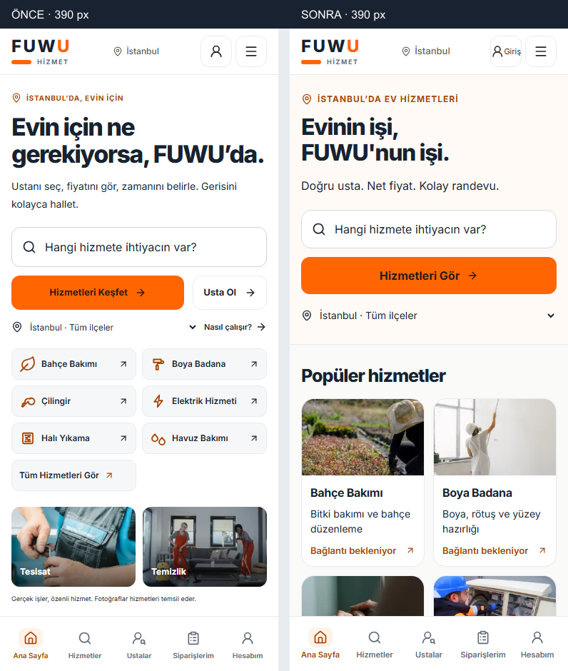
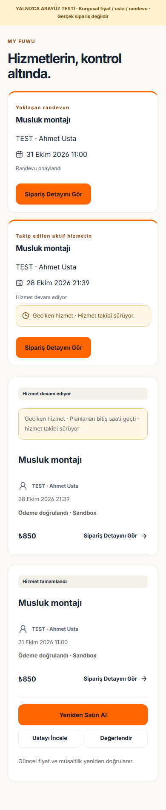
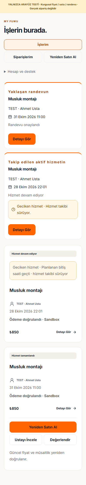
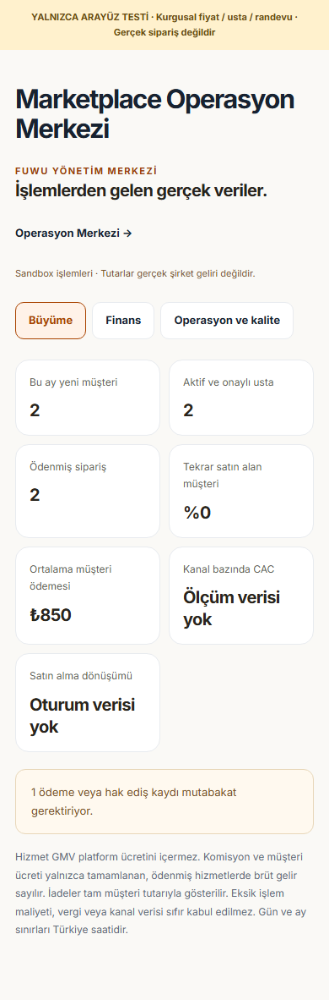
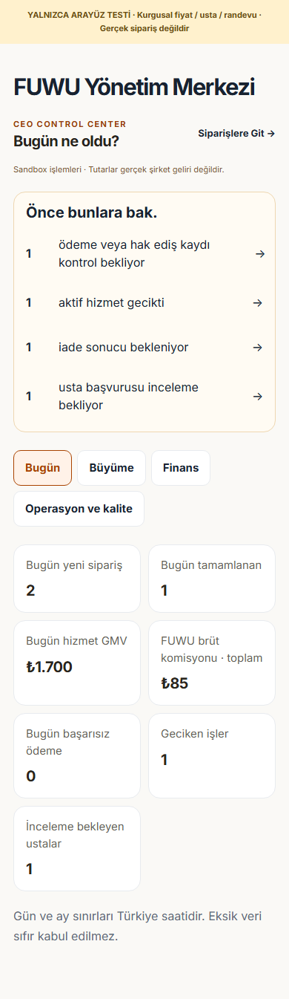

# FUWU · Premium mobil deneyim denetimi

**Tarih:** 29 Ekim 2026 · Europe/Istanbul  
**Kapsam:** Mevcut Next.js projesinde doğrudan frontend düzeltmeleri, gerçek fotoğraflar, yerel production derlemesi ve tarayıcı doğrulaması.  
**Yayın durumu:** Production'a hazır olarak onaylanmadı. Bağlı Supabase'teki ticaret şeması ve harici test kimlik bilgileri eksik. Commit, push, deployment, canlı ödeme veya production migration yapılmadı.

## 1. Önceki ekranlar ve öncelikli sorunlar

Kullanıcının `public/reference/fuwu-target-design.jpg` referansı görsel olarak incelendi. Beyaz/turuncu kimlik, kategori keşfi ve kompakt düzen esas alındı. Referanstaki yapay karakterler, doğrulanmamış sayılar ve rozetler ürüne taşınmadı. Orijinal logo değişmedi.

| Öncelik | Sorun | Sonuç |
| --- | --- | --- |
| P0 | Bağlı Supabase'te `service_catalog` ve `service_variants` yok; `reviews.order_id` eksik | **BLOCKED.** Anonim, salt okunur sorgularla doğrulandı. Satın alma kapalı tutuluyor; sahte fiyat/usta/slot eklenmedi. |
| P0 | Gerçek Google oturumu, iyzico sandbox anahtarları ve yerel Supabase Auth ortamı yok | **BLOCKED.** Harici işlem gerçekleşmiş gibi raporlanmıyor. |
| P1 | Bilinmeyen veya bozuk hizmet fotoğrafı genel tadilat fotoğrafına düşüyor | **Düzeltildi.** Tam slug eşlemesi ve nötr, metin etiketli hata durumu. |
| P1 | Halı ve havuz ikonla; beyaz eşya klima fotoğrafıyla gösteriliyor | **Düzeltildi.** Üç ayrı lisanslı gerçek fotoğraf. |
| P1 | Mobil hero, hızlı kategori tekrarı, görsel kolaj ve fayda satırı kategorileri aşağı itiyor | **Düzeltildi.** Kompakt hero, tek arama eylemi, ilk kategoriler yukarıda. |
| P1 | Ana sayfada beş adım, tekrarlanan güven ve son CTA blokları | **Düzeltildi.** Üç adım, üç güven/destek mesajı, tek Usta Ol daveti. |
| P1 | Müşteri panelinde 10 görünüm ve iki ek bağlantı aynı seviyede | **Düzeltildi.** Üç ana bağlantı; hesap/destek ikinci seviyede. |
| P1 | Usta açılışında hesap bildirimi ve tekrarlanan ayrıntılı kazanç grupları | **Düzeltildi.** Sıradaki iş, dört iş göstergesi ve kazanç bağlantısı. |
| P1 | CEO açılışı büyüme görünümüyle başlıyor; operasyon kuyruğu geri planda | **Düzeltildi.** Gerçek işlem sayılarıyla öncelikli işler ve günlük özet. |
| P1 | Takvimde seçili günün ikincil metni 3,18:1 kontrasta düşüyor | **Düzeltildi.** Koyu marka metni kullanılıyor. |
| P1 | Konum seçiminin erişilebilir adı CSS nedeniyle kayboluyor; yıldız grubunda uygun rol yok | **Düzeltildi.** Açık seçim etiketi ve puan grubu için `role="img"`. |
| P2 | Kullanılmayan Meshy dosyaları ve 3D bağımlılıkları | **Temizlendi.** 21 dosya / 22.757.816 bayt ve dört kullanılmayan bağımlılık. |
| P1 | Yavaş mobil ağ/CPU laboratuvar örneğinde LCP hâlâ hedefin üstünde | **Açık.** Gerçek sonuçlar aşağıda; production öncesinde ek hız çalışması gerekli. |

### Gerçek tarayıcıda incelenen ekranlar

Ana sayfa, tüm hizmetler, Halı Yıkama kategori görünümü, Usta Bul, gerçek bir kamuya açık usta profili, hizmet satın alma bağlantısının gerçek bağlantı hatası durumu, Usta Ol ve Google giriş sayfası açıldı. Katalogdaki **11 aktif kategorinin** varlığı, ayrı bağlantıları ve fotoğraf eşlemeleri kontrol edildi.

`/account`, `/orders`, `/provider-dashboard`, takvim, kazançlar, `/admin` ve `/admin/marketplace` anonim kullanıcıyı girişe yönlendirdi. Bu korumalı ekranlara gerçek hesapla erişilmiş olduğu iddia edilmiyor. Görsel panel kanıtları, gerçek React bileşenlerinin ayrı test uygulamasında açıkça kurgusal verilerle görüntülenmesidir.

## 2. Frontend düzeltmeleri

- Ana slogan: **“Evinin işi, FUWU'nun işi.”** Alt metin: **“Doğru usta. Net fiyat. Kolay randevu.”**
- Arama eylemi: **“Hizmetleri Gör”**. İlçe seçimi ve tüm aktif kategorilere erişim korunuyor.
- Mobilde dekoratif hero kolajı kaldırıldı; masaüstünde gerçek hizmet fotoğrafları kullanılıyor.
- Ana sayfanın ilk bölümü, aşağıdaki usta profillerinin sorgusunu beklemez. Ayrı sunucu bileşeni ve Suspense iskeleti gerçek profilleri geldiklerinde gösterir.
- DSN tanımlanmamış tarayıcı derlemesinde zaten kapalı olan Sentry SDK'sı gönderilmez. Yapılandırılmış tarayıcılar ve sunucu/Edge gerçek SDK'yı kullanmaya devam eder. Yapılandırma ayrımı birim testinde; mevcut gizlilik/logger kontrolleri ayrıca doğrulanır.
- Akış: kompakt arama → altı öne çıkan kategori → tüm hizmetler → varsa gerçek satışa açık hizmetler → üç adım → üç güven/destek mesajı → gerçek profiller → Usta Ol → sade footer.
- Tekrarlanan müşteri yorumu/tanıtım blokları ve son slogan kartı kaldırıldı. Hukuki sayfalara footer'daki açılır alandan erişiliyor.
- Usta profili hizmet ve fiyatla başlıyor; uzun tanıtım açılır alana taşındı. Gerçek satılabilir teklif varsa sticky alanda fiyat ve doğrudan satın alma bağlantısı bulunuyor. Teklif yoksa satın alınabilir izlenimi verilmiyor.
- Admin geçmiş analizleri ana sayfa açılışında sorgulanmıyor; `legacy=1` üzerinden gerektiğinde yükleniyor. Geçmiş kayıt ekranları korunuyor.

Temel dosyalar: `src/styles/mobile-experience.css`, `src/components/home/`, `src/components/commerce/`, `src/components/layout/`, `src/app/providers/`, `src/app/admin/`.

## 3. Gerçek hizmet görselleri

`src/lib/service-photos.ts` artık bilinmeyen hizmeti tadilat fotoğrafına eşlemiyor. Ortak `ServicePhoto` bileşeni kategori kartı, katalog, satın alma başlığı ve önceki talep arayüzünde kullanılıyor. Alt hizmet slug'ı kategori eşlemesinden önce aranıyor; örneğin klima bakımı, beyaz eşya fotoğrafını almıyor.

Yeni dosyalar: `appliance.webp`, `pool.webp`, `carpet.webp`. Kaynaklar, fotoğrafçılar, lisanslar, indirme adresleri, bayt boyutları ve 11 aktif kategorinin eşlemesi [fotoğraf lisans kaydında](service-photo-licenses.md).

WebP, responsive `sizes/srcset`, sabit görsel alanları ve kritik ilk kategori fotoğrafları için yükleme önceliği kullanılıyor. Fotoğraf yüklenmezse başka meslek gösterilmiyor. Eski Meshy bileşenleri ve `@react-three/drei`, `@react-three/fiber`, `three`, `gsap` kaldırıldı. Logo ve istenen referans JPG saklandı.

## 4. Metin düzenlemeleri

| Önce | Sonra |
| --- | --- |
| Evin için ne gerekiyorsa, FUWU’da. | Evinin işi, FUWU'nun işi. |
| Ustanı seç, fiyatını gör, zamanını belirle. Gerisini kolayca hallet. | Doğru usta. Net fiyat. Kolay randevu. |
| İşinizi doğru ustaya bırakın. | Ustanı tanı. Kararını ver. |
| İhtiyacınıza uygun hizmeti talep edin. | Hizmeti ve fiyatı incele, sana uygun ustayı seç. |
| Uzmanlığını daha fazla müşteriye ulaştır. | Ustalığın işe dönüşsün. |
| Sipariş Detayını Gör | Detayı Gör |
| Satın alınan hizmetlerden kazançların | Kazancın burada. |
| Bilgileriniz kaydedildi. | Bilgilerin kaydedildi. |

Aktif müşteri, satın alma, usta mağazası, kazanç, profil ve başvuru akışındaki görünen metinler kısaltıldı. Talep bekleme modeli anlatan Usta Ol / Usta Bul metinleri doğrudan satış modeline uyarlandı. Geçmiş `service_requests` kayıtları ve hukuki şartlar yeniden adlandırılmadı. Harici veritabanındaki kullanıcı açıklamaları veya ürün metinleri değiştirilmedi.

## 5. Mobil erişilebilirlik

Ana gövde ve formlar varsayılan 16px; ana eylemler en az 48px. Görünür odak, metinli ikonlar, seçili gün/saat durumu, büyük saat alanları, safe-area ve klavye açılışında alt kontrol konumları korunuyor. Fiyat, ücret ve iade metinlerine satır kırpma uygulanmıyor.

Kontrol genişlikleri: **320, 360, 375, 390, 430, 768, 1024 ve 1440px**. 320px kategori kartları tek sütuna / yatay karta geçiyor; daha geniş mobilde iki sütun kullanılıyor. Metinler Türkçe kelimelerin ortasından rastgele bölünmüyor. Katalog filtre penceresi için klavye odağı ve Escape ile kapanış; panel bileşenlerinde %200 kök yazı boyutu ve yatay görünüm ayrıca kontrol ediliyor.

Otomatik denetim axe-core ile WCAG 2 A/AA, 2.1 A/AA ve 2.2 AA etiketleri üzerinden çalıştırıldı. `incomplete` sonuçları raporda saklanır; fotoğraf üstü metin gibi otomatik karar verilemeyen alanlar AA sertifikası sayılmaz. Gerçek cihaz, VoiceOver/TalkBack ve 40–65 yaş kullanıcılarla kullanılabilirlik çalışması henüz yapılmadı.

Son otomatik sonuçlar aşağıdaki doğrulama bölümünde ve JSON kanıtlarında yer alır.

## 6. MY FUWU

Başlık **“İşlerin burada.”** Üç ana bağlantı: İşlerim, Siparişlerim, Yeniden Satın Al. Adresler, favoriler, yorumlar, ödeme bilgileri, ayarlar, bildirimler ve destek açılır ikinci seviyede.

Yaklaşan randevu ve aktif hizmet ayrı gösterilir; gelecekteki onaylı randevu aktif iş kartında tekrarlanmaz. Geciken aktif siparişler listede kalır. Yeniden satın alma bağlantısı hizmet/usta kimliğini taşır; eski fiyat veya saati taşımaz. Güncel fiyat ve müsaitlik yeniden okunur. Yalnızca uygun tamamlanmış sipariş sahibi değerlendirme yapabilir.

## 7. FUWU PARTNER

Başlık **“Bugünkü işlerin.”** Sıradaki randevu, saat, hizmet ve ilçe ile öne çıkar. Bu kayıt ayrı sorguyla bulunur; ilk 30 geçmiş/geciken aktif kaydın arasında kaybolmaz. Bugünkü randevular, yeni siparişler, devam eden ve tamamlanan işler kısa kartlardadır.

Ayrıntılı kazançlar ayrı ekranda: hizmet bedeli, FUWU komisyonu, brüt hak ediş, doğrulanmış kesinti sonrası hak ediş ve ödeme kuruluşu onay durumu. Kesinti bilgisi eksikse net hak ediş uydurulmaz. Kuruluş onayı banka transferi gibi sunulmaz. Mağaza, çalışma saatleri ve izin yönetimi mevcut API'lerle çalışır; mevcut onaylı siparişler izin eklenerek iptal edilmez.

## 8. CEO Control Center

Açılış **“Bugün ne oldu?”** Önce gerçek mutabakat, geciken hizmet, iade, uyuşmazlık ve inceleme bekleyen usta sayıları. Sıfır kayıt için alarm üretilmez. Alarm bağlantıları ilgili gerçek operasyon kuyruğuna gider. Geciken işler görünümü aktif durum ve geçmiş bitiş saatiyle sunucuda filtrelenir.

Günlük yeni sipariş, tamamlanma olayı ve başarısız ödeme sayıları sunucuda yalnızca admin rolüyle okunur. Türkiye günü başlangıç/bitiş sınırları uygulanır. Günlük GMV mevcut finans RPC'sinden gelir. Toplam komisyon günlük gelir gibi etiketlenmez. Eksik günlük veri **“Veri yok”** olur.

Büyüme, finans ve operasyon ayrıntıları ikinci görünümlerde; hızlı erişim dört temel bölüme indirildi. Yeni sipariş/ödeme operasyonu mobilde karttır. Mevcut usta yönetiminin mobil kartları korunur; eski ayrıntılı tablolar geçmiş analiz alanında kalır.

## 9. Satın alma entegrasyonu

**Hizmet → Usta → Gün/Saat → Adres → Sipariş Özeti → Ödeme** korunuyor. Yeni bir teklif bekleme formu eklenmedi. Sunucu fiyatı, uygunluk, idempotency anahtarı, açık müşteri ücreti onayı ve ödeme kuruluşu sonucu geçerli kalır.

Yerel tarayıcı testleri; hizmet/paket ve usta seçimi, slot sorgusu, adres, sipariş özeti, geri dönüş, ödeme başlangıcı, değişen ücret, sıfır ücret, ücret onayı ve OAuth taslağının geri yüklenmesini kapsar. Bu testlerde HTTP sonuçları açıkça mock'tur; gerçek Google veya iyzico işlemi değildir.

Başlangıç usta komisyonu **%10**, yapılandırılmamış müşteri platform ücreti **%0** olarak korunur. Hiçbir ek ücret veya canlı ödeme etkinleştirilmedi. Gerçek sipariş onayı doğrulanmış ödeme sonucuna bağlıdır.

## 10. Backend ve güvenlik testleri

| Kontrol | Sonuç / kapsam |
| --- | --- |
| Yerel production build | `artifacts/premium-mobile/build.log` |
| TypeScript | Yerel tip kontrolü ve Next build tip kontrolü |
| ESLint | `artifacts/premium-mobile/eslint.json` |
| İzole PostgreSQL | **86 kontrol geçti.** Gerçek TCP oturumları ve geçici yerel roller; uzaktaki Supabase'e bağlanmaz. |
| Ödeme doğrulama | **28 kontrol geçti.** Mock kuruluş HTTP; gerçek sandbox tahsilatı değildir. |
| OAuth / proxy / SSR cookie | **29 kontrol geçti.** Mock Auth HTTP ve gerçek cookie davranışı; Google hesabıyla E2E değildir. |
| FUWU3 ücret/kategori birim testleri | **3 test grubu geçti.** Varsayılan sıfır müşteri ücreti ve onay sözleşmesi korunuyor. |
| Fotoğraf / hak ediş regresyonu | Bilinmeyen meslek yalıtımı; eksik ve geçersiz kesintide net tutar gösterilmiyor. |
| Satın alma tarayıcı testleri | **13 kontrol grubu geçti.** Gerçek React bileşenleri, kurgusal veri ve mock HTTP. |

PostgreSQL kapsamı: çift rezervasyon yarışı, çakışan saatler, tekrarlanan callback, süresi dolmuş hold, geç başarılı ödeme/iade, tekil ödeme başlatma, RLS, rol yükseltme engeli, özel finans verileri, tamamlanmış siparişe bağlı yorum, değişmez fiyat/ücret onayı ve audit kayıtları.

### Son koşum özeti

- **Production build, TypeScript ve 419 dosyalık ESLint: PASS.** Lint hatası/uyarısı yok.
- **Gerçek uygulama: 8 sayfa × 8 genişlik, 0 yatay taşma ve 0 bozuk fotoğraf.** Arama, beş mobil sekme, 48px sekme hedefleri, PWA manifest/ikonları, klavye odak döngüsü, Escape, yatay görünüm ve %200 yazı boyutu kontrolleri geçti.
- **10 gerçek React bileşeni ekranı × 8 genişlik, 13 etkileşim kontrolü: PASS.** Veriler kurgusaldır.
- **Satın alma: 13 kontrol grubu, 360px dahil 8 genişlik: PASS.** API/OAuth/kuruluş yanıtları mock'tur.
- **Otomatik WCAG bulgusu: gerçek sayfalarda 0, bileşenlerde 0.** Manuel karar gerektiren incomplete kayıtları JSON dosyalarında korunur.
- **Production HTTP güvenliği: 8 kontrol grubu; Playwright giriş yönlendirmeleri: 4 test PASS.**
- **Turbopack: PASS (ısınmış derlemede sayfa ve mobil menü).** İlk soğuk istekteki zaman aşımı aşağıda belirtilir.
- **İzleme konfigürasyonu: PASS.** DSN olmayan tarayıcı için no-op; DSN olan tarayıcı ve bütün sunucu derlemelerinde gerçek SDK. Mevcut 8 logger/gizlilik kontrolü geçti.

Toplu kanıt: [quality-summary.json](../artifacts/premium-mobile/quality-summary.json). Ayrıntılar: [gerçek sayfalar](../artifacts/premium-mobile/after/public-audit.json), [bileşenler](../artifacts/premium-mobile/after-components/component-audit.json), [satın alma](../artifacts/premium-mobile/checkout/browser-tests.json), [runtime güvenliği](../artifacts/premium-mobile/runtime-http-tests.json).

### Lighthouse · son production derlemesi

Lighthouse 13.6.0 / Microsoft Edge. Mobilde varsayılan simüle ağ/CPU kısıtlaması; masaüstünde 1440px. Anonim, salt okunur backend; izleme DSN'si tanımlı değil. Bunlar tekil yerel laboratuvar örnekleridir.

| Sayfa / görünüm | Performans | Erişilebilirlik | LCP | CLS | TBT |
| --- | ---: | ---: | ---: | ---: | ---: |
| Ana sayfa · mobil | 74 | 100 | 6,44 s | 0,00011 | 198 ms |
| Hizmetler · mobil | 73 | 100 | 6,18 s | 0,00011 | 244 ms |
| Ana sayfa · masaüstü | 95 | 100 | 1,51 s | 0,00018 | 0 ms |

**Mobil LCP hedefi sağlanmadı; açık P1 maddesidir.** CLS örnekleri düşük olsa da saha yeterliliği iddia edilmez. [Resmi Web Vitals rehberi](https://web.dev/articles/vitals) iyi deneyim için LCP ≤2,5 s, CLS ≤0,1 ve INP ≤200 ms eşiklerini, gerçek ziyaretlerin %75'inde değerlendirir. Lighthouse TBT'yi INP olarak ölçmez. Saha INP **BLOCKED**.

**Üç Lighthouse raporunda da yavaş yükleme / ölçüm eksik kalabilir uyarısı var.** Skorlar üretim veya gerçek cihaz sonucu yerine kullanılmamalı. Sunucu/veri gecikmesi, ilk yük JavaScript'i ve yavaş mobil ağ ayrıca iyileştirilmeli. DSN tanımlı bir production yapısında ölçüm tekrarlanmalı.

Ham sonuçlar: [ölçümler](../artifacts/premium-mobile/performance/measurements.json), [mobil ana sayfa HTML](../artifacts/premium-mobile/performance/home-mobile.html), [mobil katalog HTML](../artifacts/premium-mobile/performance/services-mobile.html), [masaüstü HTML](../artifacts/premium-mobile/performance/home-desktop.html). Build kimliği: `7hyh7jW60kPit3-U6T2Ea`.


## 11. Önce / sonra ekran görüntüleri

### Gerçek ana sayfa · mobil



Tam sayfa: [önce](../artifacts/premium-mobile/before/home-390.png) · [sonra](../artifacts/premium-mobile/after/home-390.png).

Masaüstü: [önce 1440px](../artifacts/premium-mobile/before/home-1440.png) · [sonra 1440px](../artifacts/premium-mobile/after/home-1440.png).

### Gerçek tüm hizmetler

[Önce mobil](../artifacts/premium-mobile/before/services-390.png) · [Sonra mobil](../artifacts/premium-mobile/after/services-390.png) · [Sonra masaüstü](../artifacts/premium-mobile/after/services-1440.png).

### Panel bileşenleri · KURGUSAL VERİ

Bu görüntüler yetkili gerçek hesaba erişim kanıtı değildir. Önceki bileşenler `git show HEAD:<dosya>` ile sadece okunarak aynı izole Vite test ortamında görüntülendi. Git geçmişi değiştirilmedi. Her görüntüde görünür test uyarısı vardır.

| Müşteri · önce | Müşteri · sonra |
| --- | --- |
|  |  |

| CEO özeti · önce | CEO özeti · sonra |
| --- | --- |
|  |  |

Yeni usta açılışı: [mobil](../artifacts/premium-mobile/after-components/provider-overview-390-FIXTURE.png) · [masaüstü](../artifacts/premium-mobile/after-components/provider-overview-1440-FIXTURE.png). Kazanç: [mobil](../artifacts/premium-mobile/after-components/provider-finance-390-FIXTURE.png). Satın alma özeti: [mobil](../artifacts/premium-mobile/checkout/checkout-390-FIXTURE.png) · [masaüstü](../artifacts/premium-mobile/checkout/checkout-1440-FIXTURE.png).

## 12. Başarısız veya çalıştırılamayan kontroller

- **BLOCKED · Gerçek satın alma / randevu / ödeme:** Uzak `service_catalog`, `service_variants` ve gerekli yorum sütunları yok. Salt okunur sorgu sonuçları `external-readonly-tests.json` içindedir.
- **BLOCKED · Gerçek Google OAuth dönüşü:** Sağlayıcı ayarı açık; yetkili test oturumu ve kullanıcı etkileşimiyle tamamlanmış giriş yok. Taslak/PKCE/redirect testleri ayrı yerel testlerdir.
- **BLOCKED · Gerçek iyzico sandbox ödemesi/iade/hak ediş:** Ping 200; API/secret ve test alt üye işyeri yapılandırması yok. Bağlantı testi işlem testi sayılmaz.
- **BLOCKED · Korumalı SSR panellerde rol sahibi E2E:** Yerel Docker/Supabase Auth hizmeti çalışmadı. SQL test kullanıcıları ve roller gerçek Supabase giriş oturumu oluşturmaz. Panel fixture kontrolleri bu engelin yerine geçmiş gibi sunulmaz.
- **BLOCKED · Saha INP:** Gerçek kullanıcı oturumu örneği yok. Lighthouse TBT, INP olarak raporlanmaz.
- **Manuel kontrol gerekli:** Gerçek düşük güçlü Android/iPhone, fiziksel klavye açılışı, VoiceOver/TalkBack, çok büyük sistem yazısı ve 40–65 yaş kullanıcı denemeleri.
- Turbopack'in ilk soğuk sayfa isteği 120 saniyelik sınırı aştı; derleme ısındığında sayfa ve mobil menü testi geçti. Geçici geliştirme tipi önbelleğindeki parse hatası, kaynaklara dokunmadan önbellek temizlenerek giderildi; son `tsc --noEmit` çıkışı 0.

İlk koşumlarda bulunan takvim/sipariş adımı kontrastı, seçim etiketi, kategori başlık sırası ve puan rolü düzeltildi. Test adaptörünün görsel hata olayını iletmemesi düzeltildi. Bağımlılık temizliği sırasında eski dev sürecinin modül önbelleği geçersiz kaldı; nihai kontroller yeni production derlemesi üzerinden çalıştırıldı. Bir Lighthouse tekrarında Chromium bağlantısı kapandı; sonraki koşum Microsoft Edge ile alındı. Lighthouse yavaş yükleme uyarıları saklanır; skorlar saha verisi veya hız garantisi değildir.

## 13. Production öncesi gerekli adımlar

1. Ayrı bir Supabase test/staging projesinde mevcut migration sırasını incele; yedek ve geri dönüş planı hazırla. Özellikle `20261021000100_direct_service_commerce.sql` ile başlayan ticaret altyapısı ve sonraki operasyon/yorum/ücret migration'larının mevcut verilerle uyumunu doğrula. Production'a onaysız uygulama.
2. Gerçek hizmet kapsamı, fiyat, onaylı usta, çalışma bölgesi, takvim ve test alt üye işyeri kayıtlarıyla satışa açık teklif oluştur. Sadece kategori varlığı satın alınabilir hizmet sayılmaz.
3. Müşteri, usta ve admin için yetkili test hesaplarıyla gerçek SSR panellerini ve günlük CEO sorgularını doğrula. Özellikle admin-only okumalar, geciken siparişler ve komisyon toplamları kontrol edilmeli.
4. Google redirect izinleri, PKCE ve aynı tarayıcıda taslak dönüşünü gerçek hesapla test et. Dönüşte fiyat ve müsaitlik tekrar doğrulanmalı.
5. Yalnızca iyzico **sandbox** anahtarlarını ve test alt üye işyerini yapılandır. Başarılı/başarısız ödeme, çift callback, süresi dolmuş randevu, geç ödeme, iade ve hak ediş testlerini tamamla. Canlı ödeme açma.
6. Lighthouse'ın yavaş mobil yükleme bulgularını, ilk JavaScript maliyetini ve gerçek bağlantı koşullarını ayrıca iyileştir/ölç. Saha LCP, CLS ve INP verisini gerçek cihazlarla topla; yerel skorları production sonucu sayma.
7. Görsel/hukuki ve erişilebilirlik kontrolünden sonra commit, push, production migration veya deployment için kullanıcı onayı al.

### Tekrar çalıştırma

```powershell
node scripts/audit-premium-public.mjs
node scripts/audit-premium-components.mjs
node scripts/verify-phase2-checkout.mjs
node scripts/test-direct-commerce-db.mjs
node scripts/verify-phase3-runtime.mjs
node scripts/measure-premium-performance.mjs
```

Tarayıcı scriptlerinde `PREMIUM_BASE_URL`, runtime scriptinde `FUSION_BASE_URL`, checkout'ta `COMMERCE_OUTPUT_DIR` kullanılabilir. Yalnızca localhost URL'leri kabul edilir. Lighthouse çalışma zamanı bu görevde `artifacts/premium-mobile/lighthouse-runtime` altına kurulmuştur; uygulama bağımlılığı değildir.

Lighthouse aracını yeniden kurmak için: `npm install --prefix artifacts/premium-mobile/lighthouse-runtime --no-save --package-lock=false lighthouse@13.6.0`. Sentry DSN'si build ortamında tanımlanmalıdır; sonradan eklendiğinde yeniden derleme gerekir. İzleme ayarlıysa gerçek SDK korunur ve o yapılandırmada performans tekrar ölçülmelidir.
