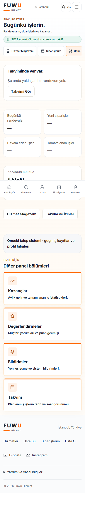
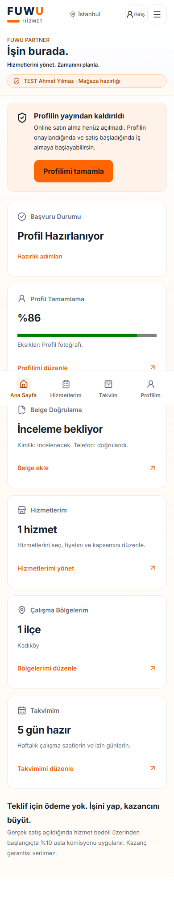
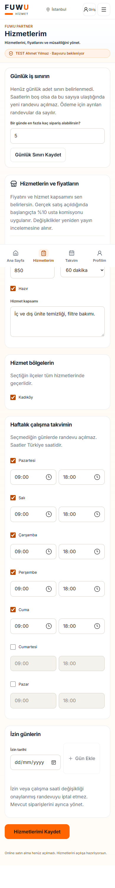
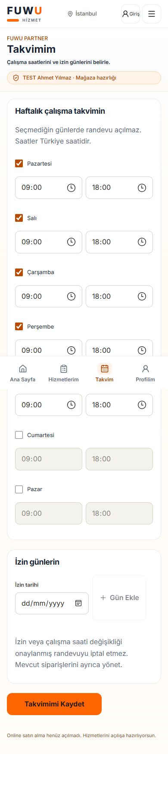
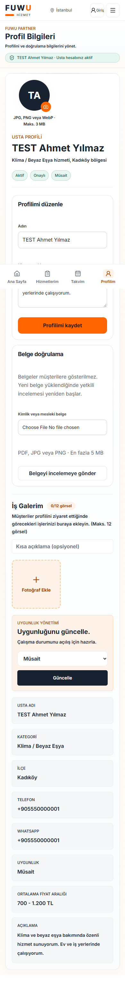

# FUWU Partner ve Control Center UX

Tarih: 30 Ekim 2026. Mevcut Next.js uygulaması ve FUWU renk/token sistemi korunarak düzenlendi. Ödeme açılmadı.

## Admin

Başlık **FUWU Control Center**, alt başlık **İşler kontrol altında.** Ana yönetim sekiz bölümden oluşur: Genel Bakış, Usta Başvuruları, Usta Yönetimi, Hizmet Kataloğu, Müşteri İlgisi, Doğrulamalar, Sistem Sağlığı, Denetim Kayıtları. Önceki sipariş/finans ve yönetim ekranları ek operasyon menüsünde korunur.

Dashboard gerçek sorgulardan bekleyen başvuruları, aktif kategori sayısını, inceleme gereken profilleri, yayındaki gerçek ustaları ve izinli müşteri ilgisini alır. Pilot ilçelerin hizmet/takvim hazırlığı ve teknik kanıt eksikleri ayrıca gösterilir. Erişim hatasında sayı uydurulmaz. Ödeme kapalıyken gelir kartları ana deneyime taşınmaz.

Usta listesi bilgi taramak içindir; gerekçeli yönetim eylemleri usta dosyasındadır. Public durum, hesap erişimi ve belge doğrulama birbirinden ayrıdır. Belgeler yalnızca yetkili özel alanda incelenir. Küçük ekranda kartların tek bağlantısı “İncele”dir.

## Partner ana ekranı

Başlık **İşin burada.**, alt bilgi **Hizmetlerini yönet. Zamanını planla.**

İlk bölüm hesap/yayın durumunu ve sıradaki ana işlemi gösterir. Altında Başvuru Durumu, Profil Tamamlama, Belge Doğrulama, Hizmetlerim, Çalışma Bölgelerim ve Takvimim kartları vardır. Hazırlık adımları açılır detayda kalır; ana ekranı uzun açıklamalar kaplamaz. Mobil alt menü dört eşit genişlikte sekmedir: Ana Sayfa, Hizmetlerim, Takvim, Profilim.

| Kavram | Kaynak / davranış |
| --- | --- |
| Başvuru alındı | Mevcut başvuru kaydı; profil yoksa başvuru takibi |
| Profil hazırlanıyor | Telefon, fotoğraf, uzmanlık, ilçe, açıklama, hizmet ve takvim eksikleri |
| Doğrulama tamamlandı | Kimlik ve telefon bayrakları ayrı okunur; otomatik yayın anlamına gelmez |
| Yayına hazır | Profil/hizmet/takvim tamam, gerekli doğrulamalar ve yayın onayı mevcut |
| Profil yüzdesi | Yedi hazırlık alanının tamamlanma oranı; kimlik veya mesleki başarı rozeti değildir |
| Performans | Bu ekranda üretilmez; ön lansmanda puan, gelir veya tamamlanma oranı uydurulmaz |

Satışın kapalı olduğu her hazırlık ekranında açıkça söylenir. “Teklif için ödeme yok. İşini yap, kazancını büyüt.” vaadi korunur. Gerçek satış açıldığında başlangıçta %10 usta komisyonu uygulanacağı ve kazanç garantisi verilmediği belirtilir.

## Çalışan hazırlık akışları

- **Hizmetlerim:** Mevcut katalogdan hizmet/paket seçimi, fiyat, süre, ustanın belirlediği kapsam, ilçeler ve hazır/kapalı durumu. Kapsam değişikliği admin incelemesine alınır. Yeni sipariş snapshot'ına onaylanan kapsam yazılır; eski sipariş kapsamı/fiyatı değiştirilmez.
- **Takvim:** Haftalık gün/saat ve izin günleri ayrı mobil ekrandadır. Saatler Türkiye saatidir. Var olan randevular otomatik iptal edilmez.
- **Profilim:** Ad/açıklama düzenleme, mevcut profil fotoğrafı ve gerçek iş görselleri yükleme bileşenleri korunur.
- **Belgeler:** PDF/JPEG/PNG, en fazla 5 MB; mevcut magic-byte doğrulaması ve özel bucket kullanılır. Dosya kendi başvurusuna server-side RPC ile bağlanır. Yeni belge eski kimlik/mesleki onayı sıfırlar ve incelemeyi yeniden başlatır; telefon doğrulaması korunur. Public URL oluşturulmaz.
- Mevcut sahipli profil hesap onayı beklerken de hazırlanabilir; tüm veri erişimi ve değişiklikler sahiplik/RLS/RPC ile yetkilendirilir. Hesap aktifleştirme veya yayın onayı usta tarafından verilemez.

Hizmet/saat kapsamı güncellendiğinde yayın kararı yeniden incelemeye döner. Gerekli alanlar/form doğrulamaları kullanıcıya yakında gösterilir. İstek sürerken gönderim engellenir; başarısızlıkta bilgiler ekranda kalır.

## Dosyalar

`PartnerOverview`, `PartnerProfileForms`, `ProviderDashboardUI`, `ProviderStore`, `MobileBottomNav`, `provider-dashboard/{page,store,calendar,profile}`, `services/providers/partner.ts`, `lib/providers/readiness.ts`, `styles/control-center.css` ve additive partner migration'ı.

## Görsel doğrulama

Gerçek yerel Next.js ile sentetik Auth/REST kullanıldı. Admin liste/detay ve partner ana sayfa/hizmet/takvim/profil ekranları 320, 375, 390, 430, 768, 1024, 1440 px genişliklerde test edildi. 42 birleşimde yatay taşma yok, browser exception yok. Etiketli form alanları, klavye odak yönetimli mevcut Dialog, `aria-current`, `role=status/alert`, geniş dokunma alanları kullanılır. Bu inceleme tam bir ekran okuyucu sertifikasyonu değildir.

Test verilerindeki profil/oturumlar sentetiktir. Görseller gerçek Google OAuth, gerçek belge yükleme servisi veya production durumunun kanıtı değildir. SQL seviyesinde sahiplik, fiyat/kapsam/saat kaydı ve belge eşleştirme ayrıca gerçek PostgreSQL üzerinde doğrulandı.

## Kalan sınırlar

Gerçek Google OAuth turu ve Supabase Storage HTTP yükleme/signed URL turu yerel servis hazır olmadığı için çalıştırılmadı. Hazırlanan gerçek E2E senaryoları `e2e/provider-control.spec.ts` dosyasındadır. Local fixture UI sonucu bu testlerin geçtiği anlamına gelmez. Canlı veritabanı eski şemadayken yeni yönetim ekranları açık kurulum hatası gösterir; migration olmadan çalıştığı iddia edilmez.
